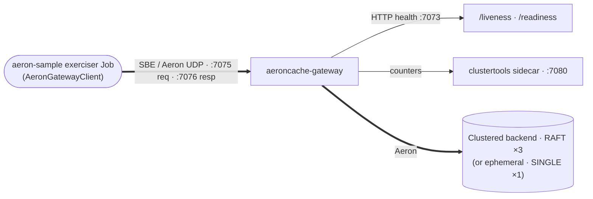

# Aeron transport gateway

> A backend plus the SBE-Aeron transport gateway — the bidirectional `bidi-aeron` interface, over
> Aeron rather than HTTP.

## Overview

This pattern deploys an Aeron Cache **backend** and the **Aeron transport gateway**
(`aeroncache-gateway`) in front of it. Unlike the http/ws/sse interfaces, the gateway speaks the
cache's native **SBE-over-Aeron** protocol (UDP) to its clients — the lowest-overhead, highest-
throughput way in, and a bidirectional (request/response + streaming) transport. This is what
"bidi-aeron" refers to.

Reach for this when a client needs the fastest path to the cache and can use the Aeron transport
(the Java and Rust client libraries do), rather than a web protocol.

**Clustered or ephemeral.** `CACHE_TYPE` selects the backend: the clustered (RAFT) cache by default,
or the single-node ephemeral (SINGLE) cache with `make up CACHE_TYPE=ephemeral`. Against ephemeral
the gateway connects to the single node's request/response-control endpoints via the gateway chart's
`EPHEMERAL_REQUEST_ENDPOINT` / `EPHEMERAL_RESPONSE_CONTROL_ENDPOINT` wiring (upstream fixed this in
chart SHA `510183b1`); only the gateway's upstream cache connection changes between modes, its
downstream client-facing Aeron ports are the same in both.

## Architecture



The gateway also runs an HTTP **health server** (`/liveness/`, `/readiness/` on 7073) and a
co-located **clustertools** sidecar that exposes the shared Aeron media-driver counters on 7080.

Since the gateway speaks only SBE-over-Aeron (curl can't drive it), `make verify` exercises the data
path with a real Aeron client: a one-shot **exerciser Job** running the published
[`aeron-sample`](https://github.com/bhf/aeron-cache-embedded/tree/main/samples/java/aeron-sample)
(`AeronGatewayClient`). The client only dials **out** to the gateway (request `:7075`,
response-control `:7076`) — the gateway creates each client's response publication lazily over an MDC
control channel — so it needs no inbound port.

## Prerequisites

- A local Kubernetes cluster via **minikube** (the default) — see the [repo README](../../README.md).
- `kubectl`, `helm`, `curl`, `jq`. Run `make doctor`.
- Runs 4 pods clustered (3 cluster nodes + gateway), or 2 pods ephemeral (1 node + gateway).

## Run

```bash
make up                       # clustered (RAFT) backend + aeron gateway
make up CACHE_TYPE=ephemeral  # single-node ephemeral (SINGLE) backend + aeron gateway
make verify                   # health + media-driver counters check
```

To use kind instead (as CI does): add `CLUSTER=kind`.

## Verify

The gateway's cache API is over Aeron (UDP), not HTTP, so there is no HTTP data round-trip to run.
Instead `make verify` ([`verify-gateway.sh`](verify-gateway.sh)):

1. checks the gateway's **liveness/readiness** (HTTP health server on 7073),
2. port-forwards to the gateway pod's **clustertools** sidecar (7080) and scrapes
   `/api/v1/clustertools/counters`, asserting a **populated counter set** — a running media driver
   always publishes system counters, so this confirms the gateway's Aeron stack is up, then
3. runs the **exerciser Job** (the published `aeron-sample`) against the gateway over UDP and asserts
   the real data-path round-trip from its logs: it connects (`Connected to gateway.`), writes and
   reads back its own item (`Get aeron-key -> aeron-value`), and completes the full scenario
   (streaming subscription, embedded cache, counters, timers → `Done.`).

A healthy deployment ends with `GATEWAY DATA-PATH OK` then `SMOKE PASSED`.

> The sample exits 0 even if it can't reach the gateway (it logs the error and returns), so the check
> asserts on **log content**, not the Job's exit status. The image is pinned in
> [`versions.env`](../../versions.env) (`AERON_SAMPLE_IMAGE` / `AERON_SAMPLE_TAG`), independent of the
> backend release, and is published from
> [bhf/aeron-cache-embedded](https://github.com/bhf/aeron-cache-embedded/tree/main/samples/java/aeron-sample).

## Near cache (optional)

The gateway can serve **hydrating subscriptions** from a **server-side near cache** — a warm local copy
kept in sync by a single cluster subscription, so hydration (and synthetic patches for patch-mode
subscribers) is served locally instead of asking the cluster for a per-subscriber snapshot. It is an
opt-in deployment option, orthogonal to `CACHE_TYPE`, that sets `nearCacheEnabled=true`
(`NEAR_CACHE_ENABLED`) on the gateway:

```bash
make up NEAR_CACHE=true                       # clustered backend + near cache on
make up NEAR_CACHE=true CACHE_TYPE=ephemeral  # ephemeral backend + near cache on
make verify-near                              # prove the gateway near cache is active and metered
```

Unlike the web gateways, the transport gateway has no HTTP data path, but it exposes the **same near
cache management API** on its HTTP health server (7073). `make verify-near` primes the near cache there
(`POST :7073/api/v1/near/cache/<id>`) and asserts the gateway's near-cache metric rose.

**Confirming it is used.** The gateway's near-cache metrics are Aeron media-driver counters (type
2100) that the co-located clustertools sidecar publishes in Prometheus format on **port 7080** (not
exposed via the Service, so port-forward the pod): `aeron_gateway_near_warm_caches{domain="cache"}` and
the `aeron_gateway_near_hydrations_served_total` hit counter. The management API lists what is warm on
the health server:

```bash
curl -s localhost:7073/api/v1/near/caches | jq .                       # warm caches + item counts
POD=$(kubectl get pod -n aeroncache-patterns -l app.kubernetes.io/name=aeroncache-gateway -o name | head -1)
kubectl port-forward -n aeroncache-patterns "$POD" 7080:7080 &
curl -s localhost:7080/prometheus | grep near                          # the near-cache counters
```

## Teardown

```bash
make down            # uninstall the gateway + backend
make cluster-down    # (optional) delete the whole cluster
```

## How it works

- **Three vendored charts** (`charts/VENDOR.lock` pins the upstream commit): `aeroncache-cluster` (the
  clustered RAFT backend), `aeroncache-ephemeral` (the single-node SINGLE backend) and
  `aeroncache-gateway` (which carries the clustertools sidecar). `CACHE_TYPE` picks the backend chart
  and, for ephemeral, sets the gateway's `ephemeralRequestEndpoint` / `ephemeralResponseControlEndpoint`
  so it connects to the single node instead of the cluster.
- **Values overlay** sets a `ClusterIP` Service so `make verify` reaches the health server via
  port-forward. The chart defaults to `LoadBalancer` to expose the Aeron UDP ports for real clients
  (use `minikube tunnel` for that locally).
- **Verify** uses `common/smoke.sh` in `command` mode (health gate), then `verify-gateway.sh` does a
  counters scrape against the gateway pod (the clustertools port 7080 is not exposed via the Service)
  and runs the **exerciser Job** ([`exerciser-job.yaml`](exerciser-job.yaml)). The Job is owned by
  verify (not `make up`): it's applied fresh, waited on, asserted from its logs, and cleaned up — so a
  completed Job pod never trips `make wait`. It gives Aeron's embedded media driver a larger `/dev/shm`
  (the default 64Mi is too small for the log buffers).

## References

- Vendored from [aeron-cache/k8s/helm](https://github.com/bhf/aeron-cache/tree/main/k8s/helm) (`aeroncache-cluster`, `aeroncache-ephemeral`, `aeroncache-gateway`; pinned SHA in `charts/VENDOR.lock`)
- [BiDi Aeron Transport Gateway SBE schema](https://github.com/bhf/aeron-cache/blob/main/cache-aeron-gateway/aeron-gateway-server/src/main/resources/sbe/gateway-schema.xml)
- Exerciser image: [`aeroncache-embedded-aeron-sample`](https://github.com/bhf/aeron-cache-embedded/tree/main/samples/java/aeron-sample) (the Aeron-gateway `AeronGatewayClient` sample, published to GHCR)
- Aeron Cache site: https://aeron-cache.pages.dev
