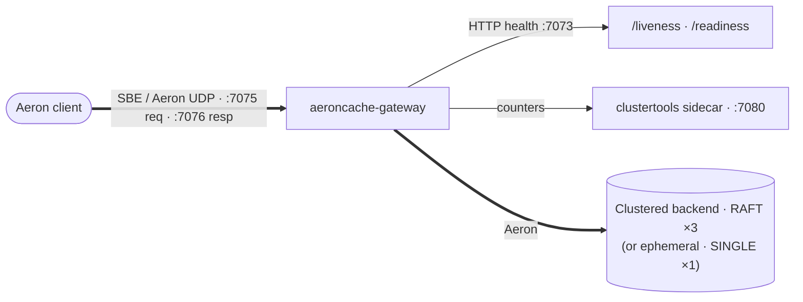

# Aeron transport gateway

> A backend plus the SBE-Aeron transport gateway — the bidirectional `bidi-aeron` interface, over
> Aeron rather than HTTP.

## Overview

This pattern deploys an Aeron Cache **backend** and the **Aeron transport gateway**
(`aeroncache-gateway`) in front of it. Unlike the http/ws/sse interfaces, the gateway speaks the
cache's native **SBE-over-Aeron** protocol (UDP) to its clients — the lowest-overhead, highest-
throughput way in, and a bidirectional (request/response + streaming) transport. This is what
"bidi-aeron" refers to.

Reach for this when a client needs the fastest path to the cache and can use the Aeron transport
(the Java and Rust client libraries do), rather than a web protocol.

**Clustered or ephemeral.** `CACHE_TYPE` selects the backend: the clustered (RAFT) cache by default,
or the single-node ephemeral (SINGLE) cache with `make up CACHE_TYPE=ephemeral`. Against ephemeral
the gateway connects to the single node's request/response-control endpoints via the gateway chart's
`EPHEMERAL_REQUEST_ENDPOINT` / `EPHEMERAL_RESPONSE_CONTROL_ENDPOINT` wiring (upstream fixed this in
chart SHA `510183b1`); only the gateway's upstream cache connection changes between modes, its
downstream client-facing Aeron ports are the same in both.

## Architecture



The gateway also runs an HTTP **health server** (`/liveness/`, `/readiness/` on 7073) and a
co-located **clustertools** sidecar that exposes the shared Aeron media-driver counters on 7080.

## Prerequisites

- A local Kubernetes cluster via **minikube** (the default) — see the [repo README](../../README.md).
- `kubectl`, `helm`, `curl`, `jq`. Run `make doctor`.
- Runs 4 pods clustered (3 cluster nodes + gateway), or 2 pods ephemeral (1 node + gateway).

## Run

```bash
make up                       # clustered (RAFT) backend + aeron gateway
make up CACHE_TYPE=ephemeral  # single-node ephemeral (SINGLE) backend + aeron gateway
make verify                   # health + media-driver counters check
```

To use kind instead (as CI does): add `CLUSTER=kind`.

## Verify

The gateway's cache API is over Aeron (UDP), not HTTP, so there is no HTTP data round-trip to run.
Instead `make verify`:

1. checks the gateway's **liveness/readiness** (HTTP health server on 7073), then
2. ([`verify-gateway.sh`](verify-gateway.sh)) port-forwards to the gateway pod's **clustertools**
   sidecar (7080) and scrapes `/api/v1/clustertools/counters`, asserting a **populated counter
   set** — a running media driver always publishes system counters, so this confirms the gateway's
   Aeron stack is actually up.

A healthy deployment ends with `GATEWAY COUNTERS OK` then `SMOKE PASSED`.

> To exercise the data path end-to-end you need an Aeron transport client (the Java or Rust client
> libraries). That is out of scope for this pattern's smoke; see the Aeron Cache client docs.

## Teardown

```bash
make down            # uninstall the gateway + backend
make cluster-down    # (optional) delete the whole cluster
```

## How it works

- **Three vendored charts** (`charts/VENDOR.lock` pins the upstream commit): `aeroncache-cluster` (the
  clustered RAFT backend), `aeroncache-ephemeral` (the single-node SINGLE backend) and
  `aeroncache-gateway` (which carries the clustertools sidecar). `CACHE_TYPE` picks the backend chart
  and, for ephemeral, sets the gateway's `ephemeralRequestEndpoint` / `ephemeralResponseControlEndpoint`
  so it connects to the single node instead of the cluster.
- **Values overlay** sets a `ClusterIP` Service so `make verify` reaches the health server via
  port-forward. The chart defaults to `LoadBalancer` to expose the Aeron UDP ports for real clients
  (use `minikube tunnel` for that locally).
- **Verify** uses `common/smoke.sh` in `command` mode (health gate) plus a counters scrape against
  the gateway pod — the clustertools port (7080) is not exposed via the Service.

## References

- Vendored from [aeron-cache/k8s/helm](https://github.com/bhf/aeron-cache/tree/main/k8s/helm) (`aeroncache-cluster`, `aeroncache-ephemeral`, `aeroncache-gateway`; pinned SHA in `charts/VENDOR.lock`)
- [BiDi Aeron Transport Gateway SBE schema](https://github.com/bhf/aeron-cache/blob/main/cache-aeron-gateway/aeron-gateway-server/src/main/resources/sbe/gateway-schema.xml)
- Aeron Cache site: https://aeron-cache.pages.dev
