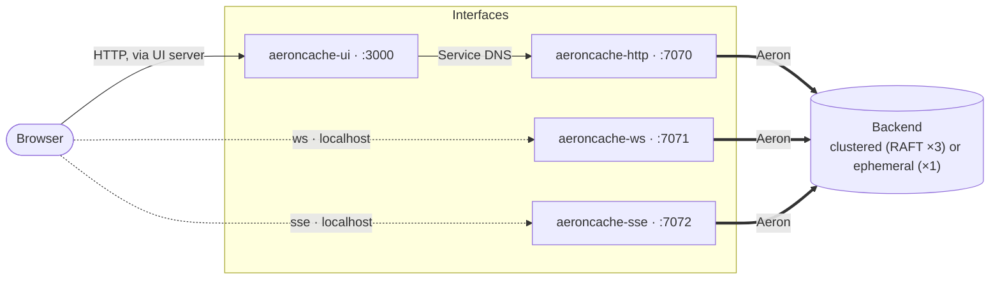

# Full stack (http + ws + sse + UI)

> The complete web stack — a backend plus all three web interfaces and the Next.js UI.

## Overview

This pattern deploys an Aeron Cache **backend** together with the **http**, **ws** and **sse**
interfaces and the **Next.js UI** (`aeroncache-ui-nextjs`) — the full front-to-back web stack, with
the UI driving all three interfaces together. For the UI in front of the single-pod monolith
instead, see the [monolith-ui](../monolith-ui/README.md) pattern.

`CACHE_TYPE` picks the backend — **`clustered`** (3-node RAFT, default) or **`ephemeral`**
(single-node SINGLE). All three interfaces are wired to the chosen backend; the UI addresses the
interfaces by Service name / localhost and is unaffected by the backend choice.

Reach for this when you want the whole thing running — a demo, a manual test environment, or a look
at the UI driving the cache.

## Architecture



The UI server proxies the cache **HTTP API** over the in-cluster Service DNS (`aeroncache-http`),
while the **browser opens ws/sse directly on localhost** via port-forward (these are the UI chart's
default endpoints — intentionally kept).

## Prerequisites

- A local Kubernetes cluster via **minikube** (the default) — see the [repo README](../../README.md).
- `kubectl`, `helm`, `curl`, `jq`. Run `make doctor`.
- Clustered runs 7 pods (3 cluster nodes + http + ws + sse + ui); ephemeral runs 5. Give the cluster
  a little headroom (a few GB) — this is the heaviest pattern.

## Run

```bash
make up                       # clustered backend + http/ws/sse + UI
# or
make up CACHE_TYPE=ephemeral  # single-node ephemeral backend + http/ws/sse + UI

make verify                   # http round-trip + UI readiness
```

To use kind instead (as CI does): add `CLUSTER=kind`.

### Open the UI

Port-forward the UI plus the ws/sse interfaces the browser connects to:

```bash
kubectl port-forward -n aeroncache-patterns svc/aeroncache-ui-nextjs 3000:3000 &
kubectl port-forward -n aeroncache-patterns svc/aeroncache-ws 7071:7071 &
kubectl port-forward -n aeroncache-patterns svc/aeroncache-sse 7072:7072 &
# then open http://localhost:3000
```

## Verify

`make verify` ([`verify-fullstack.sh`](verify-fullstack.sh)) port-forwards the http interface (7070)
and the UI (3000), checks the http interface's liveness/readiness, then:

1. runs a create/put/get round-trip against **http** (asserts the value), and
2. checks the **UI** is serving (`GET /` returns 200).

A healthy deployment ends with `FULL-STACK VERIFY PASSED` then `SMOKE PASSED`.

## Near cache (optional)

All three web interfaces (http, ws, sse) can serve reads/hydration from a **server-side near cache** —
a warm local copy kept in sync by a cluster subscription. It is an opt-in deployment option, orthogonal
to `CACHE_TYPE`, that sets `nearCacheEnabled=true` (`NEAR_CACHE_ENABLED`) on the http, ws and sse
interfaces (each keeps its own independent near cache; the UI is unaffected):

```bash
make up NEAR_CACHE=true                       # clustered backend + near cache on
make up NEAR_CACHE=true CACHE_TYPE=ephemeral  # ephemeral backend + near cache on
make verify-near                              # prove the near cache actually served a read
```

`make verify-near` creates and writes one cache, then primes and checks **each** interface's own near
cache in turn (http, ws and sse), asserting the `aeroncache_near_warm_caches` gauge rose on each
interface's `/prometheus`. Priming and the metric are plain HTTP on each interface's port, so the check
opens its own forwards to the ws (7071) and sse (7072) Services (the pattern's `make verify` only
forwards http + the UI).

**Confirming it is used.** Each web interface publishes near-cache metrics on its own `/prometheus`
(http 7070, ws 7071, sse 7072): `aeroncache_near_warm_caches{domain="cache"}` and, on the streaming
interfaces, the `aeroncache_near_hydrations_served_total` hit counter. The management API lists what is
warm, and the UI has a **Near Cache** page that lists, primes and stops caches per gateway:

```bash
curl -s localhost:7070/api/v1/near/caches | jq .     # warm caches + local item counts (http)
curl -s localhost:7070/prometheus | grep near        # the near-cache gauges/counters
```

## Observability (optional)

Add a **Prometheus + Grafana** stack that scrapes this pattern and ships a Grafana dashboard for it.
Like the near cache, it is an opt-in deployment option rather than a separate flow — the metrics are
already exposed (the pods carry the `prometheus.io/scrape` and `aeroncache.io/app-metrics-scrape`
annotations by default), so turning it on just adds the stack that collects and visualises them:

```bash
make up OBSERVABILITY=true        # deploy the pattern + Prometheus + Grafana
make observability-grafana        # port-forward Grafana -> http://localhost:3000
```

`OBSERVABILITY=true` installs the shared chart (`../../common/observability`) into the namespace and
provisions this pattern's dashboard (`dashboards/full-stack.json`, Grafana folder **Aeron Cache
Patterns**). It composes with the other options, e.g.
`make up OBSERVABILITY=true CACHE_TYPE=ephemeral`.

The starter dashboard's panels cover scrape health, JVM heap/CPU, per-operation throughput, active subscriptions and the near-cache gauges; specialise `dashboards/full-stack.json` to taste.
Confirm Prometheus discovered the pods with `make observability-prometheus`
(→ http://localhost:9090/targets).

Add it to, or remove it from, an already-running pattern on its own with `make observability-up` /
`make observability-down`; `make down` removes it too.

## Autoscaling (optional)

Put a **HorizontalPodAutoscaler** on the whole stateless web tier — the http, ws and sse interfaces and
the Next.js UI. It is an opt-in deployment option like the near cache and observability. `AUTOSCALE=true`
sets `autoscaling.enabled=true` on each of those charts, gives their pods the CPU/memory **requests** a
CPU HPA needs, and (via `make cluster-up`) installs **metrics-server**:

```bash
make up AUTOSCALE=true     # http, ws, sse and the UI each scale between 2 and 5 replicas at 60% CPU
make verify-hpa            # drive load at the http interface and watch its replica count climb
```

The bounds and target are tunable, and it composes with the other options:

```bash
make up AUTOSCALE=true HPA_MIN=2 HPA_MAX=8 HPA_CPU=50
make up AUTOSCALE=true OBSERVABILITY=true    # watch the replica counts on the Grafana dashboard
```

`make verify-hpa` seeds a cache and runs concurrent put/get load through the forwarded **http**
interface while printing `kubectl get hpa` every 15s, so it demonstrates the http interface's HPA
directly; the ws/sse/UI HPAs are installed too — drive their own traffic (ws/sse clients, or load the UI
on port 3000) to see them scale, or just watch them all with `kubectl get hpa -w -n
aeroncache-patterns`. It is an operator aid, not a CI check (metrics lag ~15–30s; replicas stay up
through the scale-down stabilization window).

> The RAFT cluster / ephemeral **backend** is never autoscaled: its membership is fixed, so scaling it
> would break consensus. `AUTOSCALE` only touches the stateless interface/UI tier.

## Teardown

```bash
make down            # uninstall the UI + interfaces + backend
make cluster-down    # (optional) delete the whole cluster
```

## How it works

- **Six vendored charts** (`charts/VENDOR.lock` pins the upstream commit): the two backends
  (`aeroncache-cluster`, `aeroncache-ephemeral`), `aeroncache-http`, `aeroncache-ws`,
  `aeroncache-sse`, and `aeroncache-ui-nextjs`.
- **`CACHE_TYPE` wiring** is applied to the http/ws/sse interfaces (same `cacheMode` /
  `clusterAddresses` / ephemeral endpoints), so all three address the same backend.
- **UI wiring**: the UI image on GHCR is `aeroncache-ui` (the local build is `aeroncache-ui-nextjs`);
  the Makefile points the image there and sets `namespace` so the UI's ConfigMap lands in this
  pattern's namespace. The endpoint defaults are kept (see Architecture). The UI Service stays
  `LoadBalancer` (its chart hardcodes `externalTrafficPolicy: Local`, invalid on a ClusterIP) —
  access is via port-forward regardless.
- **Verify** uses `common/smoke.sh` in `command` mode with a second port-forward (the UI), running
  the http round-trip plus the UI readiness check.

## References

- Vendored from [aeron-cache/k8s/helm](https://github.com/bhf/aeron-cache/tree/main/k8s/helm) (`aeroncache-cluster`, `aeroncache-ephemeral`, `aeroncache-http`, `aeroncache-ws`, `aeroncache-sse`, `aeroncache-ui-nextjs`; pinned SHA in `charts/VENDOR.lock`)
- Aeron Cache site: https://aeron-cache.pages.dev
