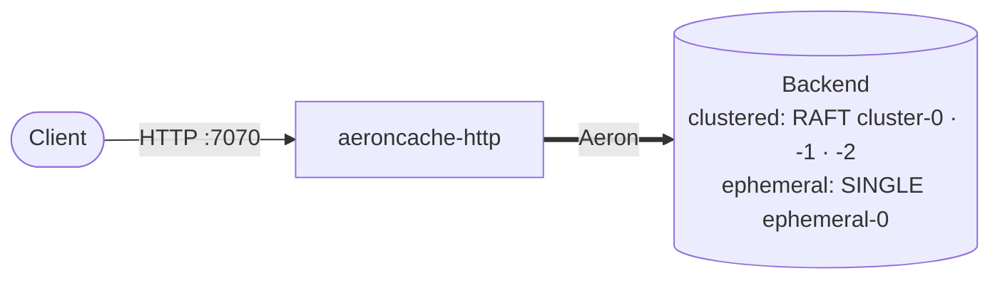

# HTTP interface

> A backend plus only the HTTP request/response interface — against a clustered or ephemeral cache.

## Overview

This pattern deploys an Aeron Cache **backend** and the **HTTP interface** (`aeroncache-http`) in
front of it — nothing else. HTTP is the request/response surface: create caches, put/get items,
counters, TTL, bulk operations, snapshot-and-purge. It is the simplest interface pattern and the
building block the other interface patterns follow.

One `CACHE_TYPE` variable picks the backend:

- **`clustered`** (default) — a 3-node RAFT cluster (`aeroncache-cluster`). Replicated and highly
  available; the interface addresses all three nodes.
- **`ephemeral`** — a single-node SINGLE-mode cache (`aeroncache-ephemeral`). One pod, no
  replication; the interface points at the one node's response-channel endpoints.

Reach for this when you want the HTTP API and nothing more — a REST integration target, a smoke
environment, or the base you extend with ws/sse/UI (see the full-stack pattern).

## Architecture



Both backends co-locate a clustertools sidecar (media-driver counters on 7080). The HTTP Service
is `aeroncache-http:7070` in either case.

## Prerequisites

- A local Kubernetes cluster via **minikube** (the default) — see the [repo README](../../README.md).
- `kubectl`, `helm`, `curl`, `jq`. Run `make doctor` from the repo root.
- The clustered variant runs 4 pods (3 cluster nodes + http); ephemeral runs 2 (1 node + http).

## Run

From this directory:

```bash
make up                       # clustered backend + http interface
# or
make up CACHE_TYPE=ephemeral  # single-node ephemeral backend + http interface

make verify                   # smoke test: create a cache, put an item, read it back
```

To use kind instead (as CI does): add `CLUSTER=kind`.

## Verify

`make verify` port-forwards `svc/aeroncache-http:7070` and runs a create/put/get round-trip against
either backend. A healthy deployment ends with `SMOKE PASSED`.

## Near cache (optional)

The http interface can serve its reads from a **server-side near cache** — a warm local copy of a
cache, kept in sync by a cluster subscription, so `GET`s resolve locally instead of round-tripping to
the cluster. It is an opt-in deployment option, orthogonal to `CACHE_TYPE` (it composes with either
backend), that sets `nearCacheEnabled=true` (`NEAR_CACHE_ENABLED`) on the interface:

```bash
make up NEAR_CACHE=true                       # clustered backend + near cache on
make up NEAR_CACHE=true CACHE_TYPE=ephemeral  # ephemeral backend + near cache on
make verify-near                              # prove the near cache actually served a read
```

`make verify-near` creates and writes a cache, primes the near cache for it
(`POST /api/v1/near/cache/<id>`), waits until it is listed warm with a local item count, and then
asserts the near-cache metric moved before reading the item back from the warm copy.

**Confirming it is used.** The http interface publishes Micrometer metrics on its own `/prometheus`
(port 7070); near caching adds `aeroncache_near_warm_caches{domain="cache"}` (and, for the streaming
interfaces, the `aeroncache_near_hydrations_served_total` hit counter). The management API lists what
is warm:

```bash
curl -s localhost:7070/api/v1/near/caches | jq .     # warm caches + local item counts
curl -s localhost:7070/prometheus | grep near        # the near-cache gauges/counters
```

## Observability (optional)

Add a **Prometheus + Grafana** stack that scrapes this pattern and ships a Grafana dashboard for it.
Like the near cache, it is an opt-in deployment option rather than a separate flow — the metrics are
already exposed (the pods carry the `prometheus.io/scrape` and `aeroncache.io/app-metrics-scrape`
annotations by default), so turning it on just adds the stack that collects and visualises them:

```bash
make up OBSERVABILITY=true        # deploy the pattern + Prometheus + Grafana
make observability-grafana        # port-forward Grafana -> http://localhost:3000
```

`OBSERVABILITY=true` installs the shared chart (`../../common/observability`) into the namespace and
provisions this pattern's dashboard (`dashboards/http.json`, Grafana folder **Aeron Cache
Patterns**). It composes with the other options, e.g.
`make up OBSERVABILITY=true CACHE_TYPE=ephemeral`.

The starter dashboard's panels cover scrape health, JVM heap/CPU, per-operation throughput, active subscriptions and the near-cache gauges; specialise `dashboards/http.json` to taste.
Confirm Prometheus discovered the pods with `make observability-prometheus`
(→ http://localhost:9090/targets).

Add it to, or remove it from, an already-running pattern on its own with `make observability-up` /
`make observability-down`; `make down` removes it too.

## Autoscaling (optional)

Put a **HorizontalPodAutoscaler** on the http interface — an opt-in deployment option like the near
cache and observability. `AUTOSCALE=true` sets `autoscaling.enabled=true` on the interface chart, gives
the pods the CPU/memory **requests** a CPU HPA needs to compute utilization against, and (via
`make cluster-up`) installs **metrics-server**, which the HPA reads:

```bash
make up AUTOSCALE=true     # the http interface scales between 2 and 5 replicas at 60% CPU
make verify-hpa            # drive load and watch the replica count climb
```

The bounds and target are tunable, and it composes with the other options:

```bash
make up AUTOSCALE=true HPA_MIN=2 HPA_MAX=8 HPA_CPU=50
make up AUTOSCALE=true OBSERVABILITY=true    # watch the replica count on the Grafana dashboard
```

`make verify-hpa` (offered here because the interface speaks HTTP) seeds a cache and runs concurrent
put/get load through the forwarded interface while printing `kubectl get hpa` every 15s: expect
`TARGETS` to cross 60% and `REPLICAS` to rise. It is an operator aid, not a CI check — metrics lag
~15–30s and replicas stay up through the HPA's scale-down stabilization window. Inspect the HPA directly
any time with `kubectl get hpa -w -n aeroncache-patterns`.

> The RAFT cluster / ephemeral **backend** is never autoscaled: its membership is fixed, so scaling it
> would break consensus. `AUTOSCALE` only touches the stateless interface tier.

## Teardown

```bash
make down            # uninstall the interface + backend
make cluster-down    # (optional) delete the whole cluster
```

## How it works

- **Three vendored charts** (`charts/VENDOR.lock` pins the upstream commit): `aeroncache-cluster`
  and `aeroncache-ephemeral` are the two backends (both run the `aeroncache-cluster` image plus the
  `aeroncache-http-clustertools` sidecar); `aeroncache-http` is the interface.
- **`CACHE_TYPE` wiring (in the Makefile).** `clustered` installs `aeroncache-cluster` and leaves
  the interface on its defaults (cacheMode `RAFT`, `clusterAddresses` templated to the namespace).
  `ephemeral` installs `aeroncache-ephemeral` in SINGLE mode and sets the interface's
  `cacheMode=SINGLE`, `clusterAddresses`, and the `ephemeralRequestEndpoint` /
  `ephemeralResponseControlEndpoint` (ports 8075/8076) at the single node.
- **Values overlay.** `values/aeroncache-http.yaml` sets a `ClusterIP` Service so `make verify`
  reaches the interface via port-forward (the chart defaults to `LoadBalancer`).

## References

- Vendored from [aeron-cache/k8s/helm](https://github.com/bhf/aeron-cache/tree/main/k8s/helm) (`aeroncache-cluster`, `aeroncache-ephemeral`, `aeroncache-http`; pinned SHA in `charts/VENDOR.lock`)
- Aeron Cache site: https://aeron-cache.pages.dev
