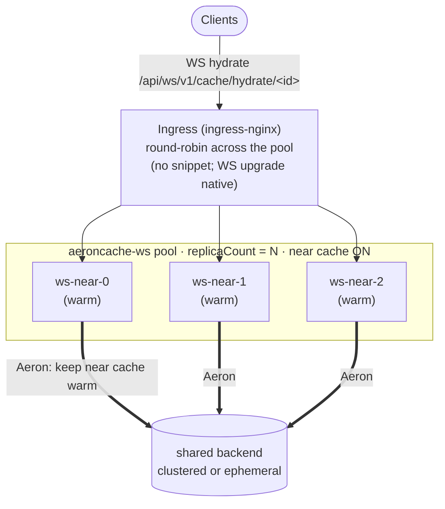

# Load-balanced hydration (WebSocket)

> Prime a **pool of near-cache gateways** and **round-robin hydrating subscriptions** across them, so
> the per-subscriber snapshot is served warm and spread over the pool. The **replication** dual of the
> **sharding** in [routing-hash-ws](../routing-hash-ws).

## Overview

A **hydrating subscription** — `ws://…/api/ws/v1/cache/hydrate/<id>` — asks the gateway to push a
point-in-time **snapshot** of the cache (one `ADD_ITEM` frame per existing item) before the live stream
begins. That snapshot is the expensive part. (The plain `/api/ws/v1/cache/<id>` subscribe streams only
*future* updates and does **not** hydrate; the `hydrate/` path is the one the near cache serves.)
The [ws pattern](../ws) shows a single gateway serving it from a **server-side near cache** — a warm
local copy — instead of round-tripping the cluster for every subscriber. One warm gateway, though, can
only build and push so many snapshots.

This pattern puts **N identical near-cache gateways** (one `aeroncache-ws` StatefulSet at
`replicaCount=GATEWAYS`) in front of **one shared backend**, **primes every one of them** for the same
caches, and load-balances subscriptions across the pool with a single Ingress:

```
hydrate /api/ws/v1/cache/hydrate/<id>  ->  round-robin across aeroncache-ws-near-0 .. -<N-1>   (all warm)
```

Every gateway holds the same caches warm, so **any** pod can serve **any** subscription — no sharding,
no sticky sessions. The hydration work spreads N ways, and because the pool is **pre-primed**, every
load-balanced subscription hits a warm copy from the first request.

```
routing-hash-ws : shard = crc32(id) % N   ->  one OWNING gateway per id   (partition caches)
hydration-lb    : round-robin over the pool -> ANY gateway serves any id   (replicate caches)
```

Reach for this when **many subscribers hydrate the same (hot) caches** and one gateway can't serve all
the snapshots. For partitioning *distinct* caches across gateways instead, see
[routing-hash-ws](../routing-hash-ws).

> **Why not just `AUTOSCALE=true` on [ws](../ws)?** An autoscaled gateway scales on load, but a
> freshly-added pod starts **cold** — its first subscribers hydrate from the cluster until it warms.
> This pattern fixes the pool size and **primes every pod up front**, so the whole pool is warm before
> traffic arrives and no load-balanced hydration is ever served cold. (For that reason `AUTOSCALE` is
> not wired here — `GATEWAYS` sets the pool size directly.)

## Architecture



One shared backend feeds `N` identical ws gateways (`GATEWAYS`, default 3), each with the near cache
on. The front door is the first-party [`common/aeroncache-lb-router`](../../common/aeroncache-lb-router)
chart: a single Ingress to the ws pool Service, which ingress-nginx load-balances across the pool's pod
endpoints (round-robin) and upgrades the WebSocket natively — **no `server-snippet`, so no
`allow-snippets`** (unlike [routing-hash-ws](../routing-hash-ws)). `CACHE_TYPE=ephemeral` swaps the
3-node backend for a single SINGLE-mode pod; the pool wiring is identical.

> **The tradeoff.** Each of the N gateways keeps its own cluster subscription to stay warm, so the
> backend sees **N× the near-cache subscription fan-in** in exchange for **N-way hydration fan-out** to
> subscribers. That is the standard read-replica trade: more upstream work to warm the replicas, far
> more downstream capacity to serve them.

## Prerequisites

- A local Kubernetes cluster via **minikube** (the default) — see the [repo README](../../README.md).
- `kubectl`, `helm`, `curl`, `jq`, and **Node 22+** (the verify uses the global `WebSocket`/`fetch`).
  Run `make doctor`.
- An **ingress-nginx controller** — `make up` installs it (`INGRESS=true` →
  [`common/ingress.sh`](../../common/ingress.sh)). Snippet annotations are **not** required.
- Headroom for the shared backend + `GATEWAYS` ws pods. Clustered ≈ `NODES + GATEWAYS` pods; ephemeral
  is far lighter (`1 + GATEWAYS`). Default `GATEWAYS=3`.

## Run

```bash
make up                          # ingress controller + shared clustered backend + 3 warm ws gateways
make up CACHE_TYPE=ephemeral     # same, single-node ephemeral backend
make up GATEWAYS=5               # a five-gateway pool
make verify                      # prime every gateway, then prove hydrations spread across the pool
```

To use kind instead (as CI does): add `CLUSTER=kind`.

## Verify

`make verify` ([verify-hydration-lb.mjs](verify-hydration-lb.mjs)) port-forwards the ingress controller
and **every pool pod**, then:

1. **Seed** — creates a cache and writes several items (over one pod's bidi WebSocket).
2. **Prime the pool** — `POST /api/v1/near/cache/<id>` to **every** gateway and waits until each lists
   the cache warm with its items (`GET /api/v1/near/caches`).
3. **Load-balanced hydration** — opens `M` (= 3·`GATEWAYS`) hydrating subscriptions
   (`/api/ws/v1/cache/hydrate/<id>`) **through the ingress**, each asserting its snapshot arrived
   (the `ADD_ITEM` frames).
4. **Proves the spread** — diffs each gateway's `aeroncache_near_hydrations_served_total`
   (its own `/prometheus`) across the run and asserts the per-gateway deltas **sum to exactly `M`** (so
   every hydration was **served from a near cache**, none fell through to the cluster) and **landed on
   at least two distinct gateways** (round-robin spread, not all on one).

A healthy run prints a per-gateway hydration table and ends with `HYDRATION LB VERIFY PASSED`.

### Try it by hand

```bash
kubectl port-forward -n ingress-nginx svc/ingress-nginx-controller 8080:80 &
# prime every pod (each has its own near cache):
for p in $(kubectl get pods -n aeroncache-patterns -l app.kubernetes.io/name=aeroncache-ws -o name); do
  kubectl port-forward -n aeroncache-patterns "$p" 7071:7071 & pf=$!; sleep 1
  curl -s -X POST localhost:7071/api/v1/near/cache/orders; kill $pf
done
# hydrate a few times; successive connects round-robin across the warm pool, each served a snapshot:
#   ws://localhost:8080/api/ws/v1/cache/hydrate/orders
```

## Near cache

The near cache is **intrinsic** to this pattern — it is always on (there is no `NEAR_CACHE=false`
form), because the whole point is a warm pool. Each gateway publishes the near-cache metrics on its own
`/prometheus` (port 7071): `aeroncache_near_warm_caches{domain="cache"}` and the
`aeroncache_near_hydrations_served_total` hit counter (a non-zero delta proves a hydration was served
from the near cache, not the cluster). The management API lists what is warm:

```bash
curl -s localhost:7071/api/v1/near/caches | jq .     # warm caches + local item counts (per pod)
curl -s localhost:7071/prometheus | grep near        # the near-cache gauges/counters (per pod)
```

## Observability (optional)

Add a **Prometheus + Grafana** stack that scrapes this pattern and ships a Grafana dashboard for it:

```bash
make up OBSERVABILITY=true        # deploy the pattern + Prometheus + Grafana
make observability-grafana        # port-forward Grafana -> http://localhost:3000
```

`OBSERVABILITY=true` installs the shared chart (`../../common/observability`) and provisions this
pattern's dashboard (`dashboards/hydration-lb.json`, Grafana folder **Aeron Cache Patterns**). Its
panels cover the per-gateway near-cache gauges and the hydrations-served counter, so you can watch the
hydration load spread across the pool. It composes with `CACHE_TYPE`, e.g.
`make up OBSERVABILITY=true CACHE_TYPE=ephemeral`.

## Teardown

```bash
make down            # uninstall the lb-router + ws pool + backend
make cluster-down    # (optional) delete the whole cluster
```

## How it works

- **One backend, a pool of readers.** `aeroncache-ws` is deployed once at `replicaCount=GATEWAYS`, all
  pods wired to the single shared backend, all with `nearCacheEnabled=true`. The chart's StatefulSet
  gives the pods stable names (`aeroncache-ws-near-<ordinal>`), so the verify can prime and scrape each
  one individually, while the pool Service fronts them all.
- **The load balancing is the edge's default.** [`common/aeroncache-lb-router`](../../common/aeroncache-lb-router)
  is a single Ingress to the ws pool Service. ingress-nginx round-robins new connections across the
  Service's pod endpoints and upgrades the WebSocket itself; the only tuning is long read/send timeouts
  for a quiet long-lived subscription. No snippet, no `allow-snippets`.
- **Pre-primed, not autoscaled.** The pool size is fixed by `GATEWAYS` and every pod is primed before
  load arrives, so each pod is warm and any load-balanced subscription is served locally. This is the
  deliberate difference from `AUTOSCALE=true`, which adds cold pods under load.

## References

- Front-door chart: [`common/aeroncache-lb-router`](../../common/aeroncache-lb-router)
- Sharding dual: [routing-hash-ws](../routing-hash-ws) · single warm gateway: [ws](../ws) (near cache)
- Controller installer: [`common/ingress.sh`](../../common/ingress.sh)
- Vendored from [aeron-cache/k8s/helm](https://github.com/bhf/aeron-cache/tree/main/k8s/helm) (`aeroncache-cluster`, `aeroncache-ephemeral`, `aeroncache-ws`; pinned SHA in `charts/VENDOR.lock`)
- Aeron Cache site: https://aeron-cache.pages.dev
