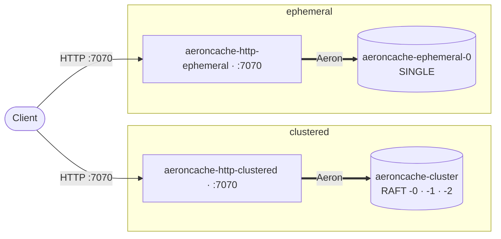

# mixed-cache-types

> Run a **clustered (RAFT)** cache and an **ephemeral (SINGLE)** cache **side by side** in one
> namespace — each with its own HTTP gateway — and verify both independently.

## Overview

Aeron Cache has two backend shapes: a **clustered** RAFT cluster (durable, consensus-backed, fixed
3-node membership) and an **ephemeral** SINGLE-mode node (one pod, no consensus, throwaway). Most
patterns pick one via `CACHE_TYPE`. This pattern deploys **both at once**, in the same namespace, to
show they coexist cleanly — a durable cache for the data you must not lose, next to a lightweight
scratch cache, each reachable on its own HTTP gateway.

Each backend is paired with its own `aeroncache-http` gateway, because a gateway binds to **exactly
one backend** at install time (one Aeron client session to one cache). So this is **two independent
`(backend, gateway)` pairs** of different types, not one deployment serving both.

Reach for this when you want to demonstrate (or build on) heterogeneous caches in one cluster — a
tier of durable + scratch storage, a migration staging ground, or a blast-radius demo where the
ephemeral cache can be torn down and recreated while the clustered one keeps its data. It is **not** a
router or a single logical cache spread across two backends: the client picks which gateway to call.
For N caches of a **single** chosen type, use the [multi-cache](../multi-cache) pattern; for one cache
behind one interface, use [http](../http).

## Architecture

Four Helm releases in one namespace — two pairs, one clustered, one ephemeral. Each gateway talks
only to its own backend over Aeron (UDP, pod-to-pod, headless-addressed); the client picks the
gateway:



- **Clustered pair** = one 3-node RAFT cluster (`aeroncache-cluster`, `NODES` to change the node
  count) + its gateway `aeroncache-http-clustered` (CLUSTER mode).
- **Ephemeral pair** = one single-node SINGLE-mode cache (`aeroncache-ephemeral`) + its gateway
  `aeroncache-http-ephemeral` (SINGLE mode, with the Aeron request/response-control endpoints wired
  to the ephemeral node).

The two backends keep their natural chart names (`aeroncache-cluster`, `aeroncache-ephemeral`), so
they never collide. The **two gateways** are renamed (`-clustered` / `-ephemeral`) and each owns its
own ConfigMap/Secret/ServiceAccount, so two `aeroncache-http` releases live in one namespace.

## Prerequisites

- A local Kubernetes cluster via **minikube** (the default) — see the [repo README](../../README.md).
- `kubectl`, `helm`, `curl`, `jq`. Run `make doctor` from the repo root to check.
- Headroom for both backends at once: the clustered cache is 3 cache pods (+ a clustertools sidecar
  each) plus a gateway, the ephemeral cache is 1 cache pod plus a gateway — ~6 pods at the default
  `NODES=3`. Scale `NODES` to your cluster.

## Run

From this directory:

```bash
make up            # clustered (3-node RAFT) + ephemeral (SINGLE), a gateway each
make up NODES=5    # same, but 5 RAFT nodes for the clustered backend
make verify        # create/put/get against each gateway in turn
```

To use kind instead (as CI does): `make up CLUSTER=kind`.

There is no `CACHE_TYPE` here — this pattern always deploys one of **each** type; that is the point.
(For N caches of a single chosen type, use the [multi-cache](../multi-cache) pattern.)

## Verify

`make verify` runs [verify-mixed.sh](verify-mixed.sh): for each gateway it port-forwards the Service,
creates a cache, puts an item, and asserts it reads back — an independent round-trip against the
clustered gateway and the ephemeral gateway. A healthy run ends with
`BOTH CACHES (clustered + ephemeral) PASSED`. Because each gateway fronts its own backend of a
different type, this proves both cache types are serving at once in the same namespace.

## Observability (optional)

The shared **Prometheus + Grafana** stack works unchanged — everything is in one namespace, so one
scrape target set discovers both gateways and the clustertools sidecars:

```bash
make up OBSERVABILITY=true
make observability-grafana     # port-forward Grafana -> http://localhost:3000
```

The provisioned dashboard ([dashboards/mixed-cache-types.json](dashboards/mixed-cache-types.json)) is
a starter over the metrics the gateways expose; filter/group by pod or release to separate the
clustered gateway from the ephemeral one.

## Autoscaling (optional)

Both gateways are a stateless interface tier, so they can carry a HorizontalPodAutoscaler.
`AUTOSCALE=true` applies it to **both** gateways (never the RAFT/ephemeral backends — their
membership is fixed):

```bash
make up AUTOSCALE=true     # each gateway scales 2..5 at 60% CPU (HPA_MIN/HPA_MAX/HPA_CPU tune it)
make verify-hpa            # drive load at the clustered gateway and watch its HPA scale up
```

## Near cache (optional)

`NEAR_CACHE=true` enables the server-side near cache on both gateways (composes with `NODES` /
`AUTOSCALE`). This pattern ships no `verify-near` of its own — confirm it via each gateway's
`/prometheus` near gauges, or the [http](../http) pattern's near verify against a single instance.

## Teardown

```bash
make down            # uninstall both backends and both gateways from the namespace
make cluster-down    # (optional) delete the whole cluster
```

## How it works

The upstream charts are written as **singletons** — one cache, one gateway, fixed names. Here the two
**backends** keep their natural chart names (`aeroncache-cluster`, `aeroncache-ephemeral`), so they
don't collide with each other. The problem is the two **http gateways**: two `aeroncache-http`
releases in one namespace would both try to create an `aeroncache-http`-named ConfigMap, Secret,
Service and ServiceAccount.

This pattern vendors the same `aeroncache-cluster`, `aeroncache-ephemeral` and `aeroncache-http`
charts as [multi-cache](../multi-cache), with the same **local edits** (each marked
`mixed-cache-types edit:` in the templates, and listed in [charts/VENDOR.lock](charts/VENDOR.lock))
that parametrise the names the single-instance patterns got to leave constant:

- **Names derive from the release.** `fullnameOverride` and `serviceAccount.name` are blanked so each
  gateway's Service/ServiceAccount take its own release name (`aeroncache-http-clustered`,
  `aeroncache-http-ephemeral`).
- **ConfigMap names are a value.** The gateway ConfigMap `metadata.name` reads
  `aeroncacheHTTPConfigmap`, which the Makefile sets per gateway, so each release owns its own config
  (the Deployment reads the same value via `envFrom`).
- **The Secret name derives from the fullname** so it doesn't collide either.

The Makefile installs four releases: the clustered backend and its gateway (gateway's
`clusterAddresses` → the RAFT peers, CLUSTER mode), then the ephemeral backend and its gateway
(`cacheMode=SINGLE`, `clusterAddresses` → the ephemeral node, and the Aeron
`ephemeralRequestEndpoint` / `ephemeralResponseControlEndpoint` pointed at that node — the node
advertises its response-control address for the Aeron response channel). The two caches are entirely
**independent**: no shared consensus, no shared logical cache, no data migration between them.

> These chart edits are local to this pattern. Re-running `scripts/sync-charts.sh` re-vendors the
> upstream charts and **overwrites** them — re-apply the `mixed-cache-types edit:` changes after a
> refresh.

## References

- Vendored from upstream charts: [aeron-cache/k8s/helm](https://github.com/bhf/aeron-cache/tree/main/k8s/helm) (pinned SHA in `charts/VENDOR.lock`)
- The single-type fan-out: the [multi-cache](../multi-cache) pattern
- Single-instance building block: the [http](../http) pattern
- Aeron Cache site: https://aeron-cache.pages.dev
