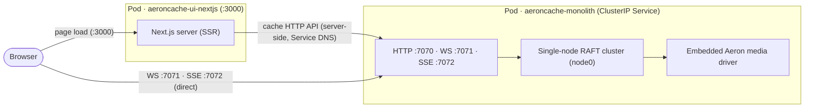

# Monolith + UI

> The monolith — a single-node Aeron Cache cluster and the HTTP/WS/SSE interfaces in one
> self-contained pod — with the Next.js UI in front of it.

## Overview

The **monolith-ui** pattern runs the [monolith](../monolith/README.md) backend together with the
Aeron Cache **Next.js UI**. The monolith is a single pod that embeds a single-node cluster, its own
media driver, and the HTTP, WebSocket and SSE interfaces; the UI is a second pod that renders the
web front end and talks to those interfaces.

Reach for this when you want the *smallest* way to run Aeron Cache **with a web UI** — a demo, a
local playground, or a first visual look at the cache. It is the monolith's single-pod simplicity
plus a front end, and nothing else: no external cluster, no gateway, and no separate http/ws/sse
deployments (the monolith already serves all three).

If you want the UI in front of a real, horizontally-scalable backend with the interfaces deployed
independently (clustered or ephemeral), use the [full-stack](../full-stack/README.md) pattern
instead. This pattern trades that scalability for the monolith's minimal footprint.

## Architecture

Two charts, two pods, two Services — the monolith backend and the UI:



How the UI reaches the backend — the one wiring detail that matters:

- **api** is fetched **server-side** from the UI pod, so it targets the monolith's in-cluster
  Service DNS: `http://aeroncache-monolith:7070/api/v1`. This is the override the UI chart documents
  for the monolith (it defaults to the split `aeroncache-http` interface).
- **ws** and **sse** are opened by the **browser**, so they stay on `localhost` and reach the
  monolith's `7071`/`7072` via `kubectl port-forward`. The monolith exposes those on the same port
  numbers the split interfaces use, so no UI change is needed beyond the `api` endpoint.

## Prerequisites

- A local Kubernetes cluster via **minikube** (the default) — see the [repo README](../../README.md).
- `kubectl`, `helm`, `curl`, `jq`. Run `make doctor` from the repo root.
- No extra prerequisites — the backend is the self-contained monolith.

## Run

From this directory:

```bash
make up        # start minikube, deploy the monolith + UI, wait for both pods to be Ready
make verify    # smoke test: HTTP round-trip against the monolith + UI readiness
```

To use kind instead (as CI does): `make up CLUSTER=kind`.

## Verify

`make verify` port-forwards the monolith's HTTP interface (`svc/aeroncache-monolith:7070`) and the
UI (`svc/aeroncache-ui-nextjs:3000`), runs a create/put/get round-trip against the monolith, and
checks the UI returns `200` on `/`. A healthy deployment ends with `MONOLITH-UI VERIFY PASSED`.

### Use the UI in a browser

Port-forward the UI plus the monolith's ws/sse ports (the browser opens those two directly):

```bash
kubectl port-forward -n aeroncache-patterns svc/aeroncache-ui-nextjs 3000:3000 &
kubectl port-forward -n aeroncache-patterns svc/aeroncache-monolith 7071:7071 &   # ws
kubectl port-forward -n aeroncache-patterns svc/aeroncache-monolith 7072:7072 &   # sse
# then open http://localhost:3000
```

The UI's server-side calls to the cache HTTP API go over in-cluster Service DNS, so they work
without a port-forward; only ws and sse need one because the browser opens them itself.

## Observability (optional)

Add a **Prometheus + Grafana** stack that scrapes this pattern and ships a Grafana dashboard for it.
It is an opt-in deployment option rather than a separate flow — the metrics are
already exposed (the pods carry the `prometheus.io/scrape` and `aeroncache.io/app-metrics-scrape`
annotations by default), so turning it on just adds the stack that collects and visualises them:

```bash
make up OBSERVABILITY=true        # deploy the pattern + Prometheus + Grafana
make observability-grafana        # port-forward Grafana -> http://localhost:3000
```

`OBSERVABILITY=true` installs the shared chart (`../../common/observability`) into the namespace and
provisions this pattern's dashboard (`dashboards/monolith-ui.json`, Grafana folder **Aeron Cache
Patterns**). It layers onto the normal lifecycle and is reapplied by `make redeploy`.

The starter dashboard's panels cover scrape health, JVM heap/CPU, per-operation throughput, cache request rates and active subscriptions; specialise `dashboards/monolith-ui.json` to taste.
Confirm Prometheus discovered the pods with `make observability-prometheus`
(→ http://localhost:9090/targets).

Add it to, or remove it from, an already-running pattern on its own with `make observability-up` /
`make observability-down`; `make down` removes it too.

## Teardown

```bash
make down            # uninstall the UI and the monolith
make cluster-down    # (optional) delete the whole cluster
```

## How it works

- **Two charts, one image each.** The pattern vendors `aeroncache-monolith` and
  `aeroncache-ui-nextjs` (see `charts/VENDOR.lock` for the pinned upstream commit). The Makefile
  points each chart's `image` at its GHCR image (`aeroncache-monolith`, `aeroncache-ui`) at the
  release pinned in the repo's `versions.env`.
- **Backend overlay.** `values/aeroncache-monolith.yaml` is the same tiny overlay as the standalone
  monolith: a `ClusterIP` Service and an explicit `cacheMode: RAFT`.
- **UI overlay.** `values/aeroncache-ui-nextjs.yaml` overrides only the `api` endpoint (to the
  monolith Service), keeps the UI Service at its default `LoadBalancer` (the chart hardcodes
  `externalTrafficPolicy: Local`, invalid on `ClusterIP`), and relaxes the UI probes so a slow
  server-rendered `/` does not get liveness-killed while the monolith is still warming up. The
  Makefile sets `--set namespace=$(NAMESPACE)` so the UI's ConfigMap lands in the right namespace.
- **No interface deployments.** Unlike full-stack, there is no `aeroncache-http`/`ws`/`sse` here —
  the monolith serves all three from one pod, which is the whole point of the pattern.

## References

- Vendored from [aeron-cache/k8s/helm](https://github.com/bhf/aeron-cache/tree/main/k8s/helm) — `aeroncache-monolith` and `aeroncache-ui-nextjs` (pinned SHA in `charts/VENDOR.lock`)
- The backend-only variant: [monolith](../monolith/README.md)
- The scalable web stack: [full-stack](../full-stack/README.md)
- Aeron Cache site: https://aeron-cache.pages.dev
