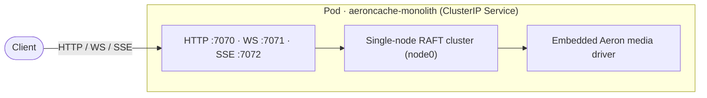

# Monolith

> The whole of Aeron Cache — a single-node cluster and the HTTP/WS/SSE interfaces — in one
> self-contained pod.

## Overview

The **monolith** runs a single-node Aeron Cache cluster together with the HTTP, WebSocket and
SSE interfaces inside a single process and a single pod. Everything talks to itself over
localhost, and the process launches its own embedded Aeron media driver — so there is no
external cluster, no gateway, and no media-driver sidecar to wire up.

Reach for this pattern when you want the smallest possible footprint: a demo, a local
integration target, a CI dependency, or a first look at the HTTP API. It is **not** horizontally
scalable (the embedded cluster is one node) and has no RAFT replication across pods — for those,
see the clustered and gateway patterns. Everything you do against the monolith's HTTP API maps
one-to-one onto the clustered deployments, so it is also the natural place to start learning.

This is the reference pattern for the repo: it exercises the whole toolchain (vendored chart →
pinned GHCR image → `make up` → smoke test) with the least moving parts.

## Architecture

One StatefulSet, one pod, one image (`ghcr.io/bhf/aeroncache-monolith`), one Service:



Ports: HTTP `7070`, WS `7071`, SSE `7072`, ClusterTools `7080`. The embedded media driver's
shared memory is backed by an in-memory `shm` volume.

## Prerequisites

- A local Kubernetes cluster via **minikube** (the default) — see the [repo README](../../README.md).
- `kubectl`, `helm`, `curl`, `jq`. Run `make doctor` from the repo root.
- No extra prerequisites — the monolith is fully self-contained.

## Run

From this directory:

```bash
make up        # start minikube, deploy the monolith, wait for the pod to be Ready
make verify    # smoke test: create a cache, put an item, read it back
```

To use kind instead (as CI does): `make up CLUSTER=kind`.

## Verify

`make verify` port-forwards the HTTP interface (`svc/aeroncache-monolith:7070`) and runs a
create/put/get round-trip. A healthy deployment ends with `SMOKE PASSED`.

You can also drive it by hand once it is up:

```bash
kubectl port-forward -n aeroncache-patterns svc/aeroncache-monolith 7070:7070 &
curl -s localhost:7070/readiness/
curl -s -X POST localhost:7070/api/v1/cache -H 'Content-Type: application/json' -d '{"cacheId":"demo"}'
curl -s -X POST localhost:7070/api/v1/cache/demo -H 'Content-Type: application/json' -d '{"key":"k","value":"v"}'
curl -s localhost:7070/api/v1/cache/demo/k
```

## Observability (optional)

Add a **Prometheus + Grafana** stack that scrapes this pattern and ships a Grafana dashboard for it.
It is an opt-in deployment option rather than a separate flow — the metrics are
already exposed (the pods carry the `prometheus.io/scrape` and `aeroncache.io/app-metrics-scrape`
annotations by default), so turning it on just adds the stack that collects and visualises them:

```bash
make up OBSERVABILITY=true        # deploy the pattern + Prometheus + Grafana
make observability-grafana        # port-forward Grafana -> http://localhost:3000
```

`OBSERVABILITY=true` installs the shared chart (`../../common/observability`) into the namespace and
provisions this pattern's dashboard (`dashboards/monolith.json`, Grafana folder **Aeron Cache
Patterns**). It layers onto the normal lifecycle and is reapplied by `make redeploy`.

The starter dashboard's panels cover scrape health, JVM heap/CPU, per-operation throughput, cache request rates and active subscriptions; specialise `dashboards/monolith.json` to taste.
Confirm Prometheus discovered the pods with `make observability-prometheus`
(→ http://localhost:9090/targets).

Add it to, or remove it from, an already-running pattern on its own with `make observability-up` /
`make observability-down`; `make down` removes it too.

## Teardown

```bash
make down            # uninstall the monolith
make cluster-down    # (optional) delete the whole cluster
```

## How it works

- **One chart, one image.** The pattern vendors only `aeroncache-monolith` (see
  `charts/VENDOR.lock` for the pinned upstream commit). The Makefile points the chart's `image`
  at `ghcr.io/bhf/aeroncache-monolith` at the release pinned in the repo's `versions.env`.
- **Values overlay.** `values/aeroncache-monolith.yaml` keeps the overlay tiny: a `ClusterIP`
  Service (we access it via port-forward) and an explicit `cacheMode: RAFT`. The chart defaults
  to a `LoadBalancer` Service; to use that locally, drop the override and run `minikube tunnel`.
- **Embedded everything.** The monolith launches its own single-node cluster and media driver
  in-process (`MONOLITH_EMBEDDED_DRIVER=true`), which is what makes it a single pod with no
  sidecars.

## References

- Vendored from [aeron-cache/k8s/helm/aeroncache-monolith](https://github.com/bhf/aeron-cache/tree/main/k8s/helm/aeroncache-monolith) (pinned SHA in `charts/VENDOR.lock`)
- Upstream monolith helm CI: [helm-ci-monolith.yaml](https://github.com/bhf/aeron-cache/blob/main/.github/workflows/helm-ci-monolith.yaml)
- Aeron Cache site: https://aeron-cache.pages.dev
