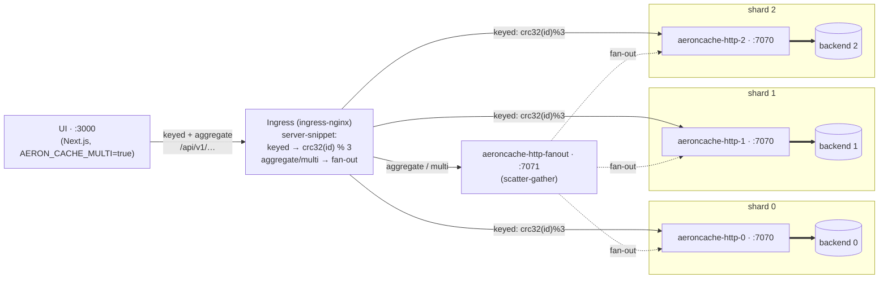

# Multi-cache + UI (hash sharding + fan-out)

> **N cache shards, one front door, one UI.** Keyed operations **hash on the cache id** to the shard
> that owns them; cross-cache operations **fan out** across every shard — so the UI drives a single
> API base and still shows the whole multi-cache deployment.

## Overview

A single cache behind a single gateway is easy to put a UI in front of — that is the
[full-stack](../full-stack) pattern. But a **multi-cache** deployment (many independent caches, each
with its own gateway and backend) breaks the UI's one assumption: that there is one place to send
every request. Two kinds of request now pull in opposite directions:

- **Keyed, per-cache operations** — create / put / get / delete on `/api/v1/cache/<id>` (and the
  counter equivalents). Each cache id lives on exactly one shard, so these must go to the shard that
  owns the id.
- **Cross-cache operations** — "list every cache", aggregate stats, snapshot info across the whole
  deployment. These must touch **all** shards and merge the results.

This pattern wires both behind **one Ingress**, so the UI points a single `AERON_CACHE_API` at it:

```
                              ┌─ keyed  /api/v1/cache|counters/<id> …
browser ─ UI :3000 ─(server)─▶ Ingress ─┤        → crc32(cacheId) % N → aeroncache-http-<shard> → backend<shard>
                              └─ aggregate /caches /stats /snapshot[-info] /multi/* …
                                       → aeroncache-http-fanout :7071 → scatter-gather EVERY shard
```

The pay-off is the demo: the UI **lists caches that live on different shards** (the fan-out union)
while **operating on any one of them keys to its owning shard** (the hash). Add a cache the router has
never seen and it routes deterministically with no new configuration.

## Architecture



- **The shards** are the [multi-cache](../multi-cache) / [routing-hash-http](../routing-hash-http)
  fan-out: `N` independent `(backend, http gateway)` pairs (`N` = `SHARDS`, default 3). With
  `CACHE_TYPE=ephemeral` (the default here) each backend is one SINGLE-mode pod; `clustered` makes it
  a 3-node RAFT cluster.
- **The front door** is the first-party [`common/aeroncache-hash-router`](../../common/aeroncache-hash-router)
  chart in its **fan-out mode** (`fanout.enabled=true`). Its `server-snippet` adds regex locations
  that (a) capture the cache id from the keyed paths and `proxy_pass` to `aeroncache-http-<crc32(id)%N>`,
  and (b) send the aggregate / `/multi/*` paths to the fan-out Service. Keyed responses carry the
  chosen shard in the `X-Aeroncache-Shard` header; aggregate responses carry `X-Aeroncache-Shard: fanout`.
- **The aggregator** is the upstream **`aeroncache-http-fanout`** chart (new in this release): a
  stateless scatter-gather service that reads `GATEWAY_ADDRESSES` (every shard's gateway) and merges
  their `/caches`, `/stats`, `/snapshot-info`, … responses, plus the per-backend `/multi/*` variants.
- **The UI** is the upstream `aeroncache-ui-nextjs` with `AERON_CACHE_MULTI=true`, so its snapshot /
  info views use the `/api/v1/multi/...` endpoints and render **one result per backend**. Its
  `AERON_CACHE_API` is fetched server-side from the UI pod, so it targets the in-cluster ingress-nginx
  controller Service.

## Prerequisites

- A local Kubernetes cluster via **minikube** (the default) — see the [repo README](../../README.md).
- `kubectl`, `helm`, `curl`, `jq`. Run `make doctor` from the repo root. (`python3`, if present, is
  used by the verify for an independent hash cross-check; it is optional.)
- An **ingress-nginx controller with snippet annotations enabled** — `make up` installs the controller
  (`INGRESS=true` → [`common/ingress.sh`](../../common/ingress.sh)) **and** turns on snippet
  annotations (`ingress.sh allow-snippets`); you do not need to do either by hand.
- Headroom for `N` backends + `N` gateways + the fan-out + the UI. The default `SHARDS=3` **ephemeral**
  is ~8 pods; `CACHE_TYPE=clustered` is ~14 (each shard becomes a 3-node cluster) — drop to `SHARDS=2`
  on a small cluster.

## Run

From this directory:

```bash
make up                          # ingress (+snippets) + 3 ephemeral shards + fan-out + hash-router + UI
make up CACHE_TYPE=clustered     # same, but each shard is a 3-node RAFT cluster
make up SHARDS=2                 # two shards instead of three
make verify                      # prove hash sharding + fan-out aggregation + UI readiness
```

To use kind instead (as CI does): add `CLUSTER=kind`.

### Open the UI

```bash
kubectl port-forward -n aeroncache-patterns svc/aeroncache-ui-nextjs 3000:3000
# then browse http://localhost:3000 — the cache list is the fan-out union across all shards;
# creating/opening a cache keys to its owning shard.
```

## Verify

`make verify` ([verify-multi-cache-ui.sh](verify-multi-cache-ui.sh)) port-forwards the Ingress, every
gateway, the fan-out and the UI, writes a spread of cache ids **through the Ingress**, and asserts:

1. **Keyed hash routing** — each id writes and reads back through the Ingress; the Ingress reports the
   shard it picked (`X-Aeroncache-Shard`); reading each id **directly** from the `N` gateways finds it
   on **exactly one** — the shard the header named (rules out round-robin / a shared backend); the id
   set spans ≥ 2 shards; and (if `python3` is present) the owner equals `crc32(id) % N` computed
   independently.
2. **Fan-out aggregation** — `GET /api/v1/caches` through the Ingress (→ fan-out) returns the **union**
   of every gateway's caches: it contains all the written ids, **none of which any single gateway holds
   alone** (they are sharded), so the union can only have come from aggregating ≥ 2 backends. And
   `GET /api/v1/multi/snapshot-info` returns **one entry per backend** (a list of length `N`).
3. **UI readiness** — the UI serves (`GET /` → 200).

A healthy run ends with `MULTI-CACHE-UI VERIFY PASSED`.

### Try it by hand

```bash
kubectl port-forward -n ingress-nginx svc/ingress-nginx-controller 8080:80
# keyed op — hashes to a shard (see the header):
curl -X PUT  localhost:8080/api/v1/cache/orders
curl -i      localhost:8080/api/v1/cache/orders/k      # -> X-Aeroncache-Shard: 2
curl -X PUT  localhost:8080/api/v1/cache/users         # a different id → likely a different shard
# cross-cache op — fans out across every shard:
curl -i      localhost:8080/api/v1/caches              # -> union of all shards, X-Aeroncache-Shard: fanout
curl         localhost:8080/api/v1/multi/snapshot-info # -> one entry per backend
```

## Scope

This cut is **http + fan-out + UI**. The UI's live-streaming views (ws/sse) are left at their
localhost defaults and are **out of scope**: streaming across a multi-cache deployment needs per-shard
stream routing — see [routing-hash-ws](../routing-hash-ws) / [routing-hash-sse](../routing-hash-sse).
Everything this pattern demonstrates (cache CRUD and the multi-cache snapshot / info views) is over
http.

## Teardown

```bash
make down            # uninstall the UI + fan-out + hash-router + every shard release in the namespace
make cluster-down    # (optional) delete the whole cluster
```

(The snippet-annotation setting stays on the shared controller; it is harmless and only affects
Ingresses that carry a snippet.)

## How it works

- **Two routes, one base.** The UI points a single `AERON_CACHE_API` at the Ingress. The
  [`common/aeroncache-hash-router`](../../common/aeroncache-hash-router) snippet, in fan-out mode,
  splits that base: the aggregate / `/multi/*` paths (plural/dashed/verb paths like `/caches`,
  `/counters-caches`, `/snapshot`, `/multi/snapshot-info`) go to the fan-out Service; the singular
  keyed paths (`/cache/<id>…`, `/counters/<id>…`) hash on the cache id. The id is the path segment
  after `/cache/` or `/counters/`, except the `timed` / `increment` / `decrement` / `set` verbs, where
  it follows the verb — the snippet captures both forms so **every operation for an id hashes to the
  same shard**.
- **The aggregator is stateless.** `aeroncache-http-fanout` holds no cluster connection; it simply
  calls every gateway in `GATEWAY_ADDRESSES` and merges. The Makefile builds that list from the
  pattern's own shard gateway Services.
- **Snippets must be allowed.** ingress-nginx disables snippet annotations by default (since v1.9);
  [`common/ingress.sh allow-snippets`](../../common/ingress.sh) enables them and restarts the
  controller. `make up` and CI ([prereqs.sh](prereqs.sh)) both call it, so local and CI never drift.
- **One local chart patch.** The upstream UI chart does not template `AERON_CACHE_MULTI` yet, so this
  pattern's vendored copy adds one optional ConfigMap key (`endpoints.multi`) — see
  [`charts/VENDOR.lock`](charts/VENDOR.lock). Everything else is stock upstream charts.

## References

- Front-door chart: [`common/aeroncache-hash-router`](../../common/aeroncache-hash-router) (fan-out mode)
- Building blocks: [multi-cache](../multi-cache) · [routing-hash-http](../routing-hash-http) · [full-stack](../full-stack)
- Streaming across shards: [routing-hash-ws](../routing-hash-ws) · [routing-hash-sse](../routing-hash-sse)
- Controller installer: [`common/ingress.sh`](../../common/ingress.sh)
- Vendored from upstream charts: [aeron-cache/k8s/helm](https://github.com/bhf/aeron-cache/tree/main/k8s/helm) (pinned SHA in `charts/VENDOR.lock`)
- Aeron Cache site: https://aeron-cache.pages.dev
