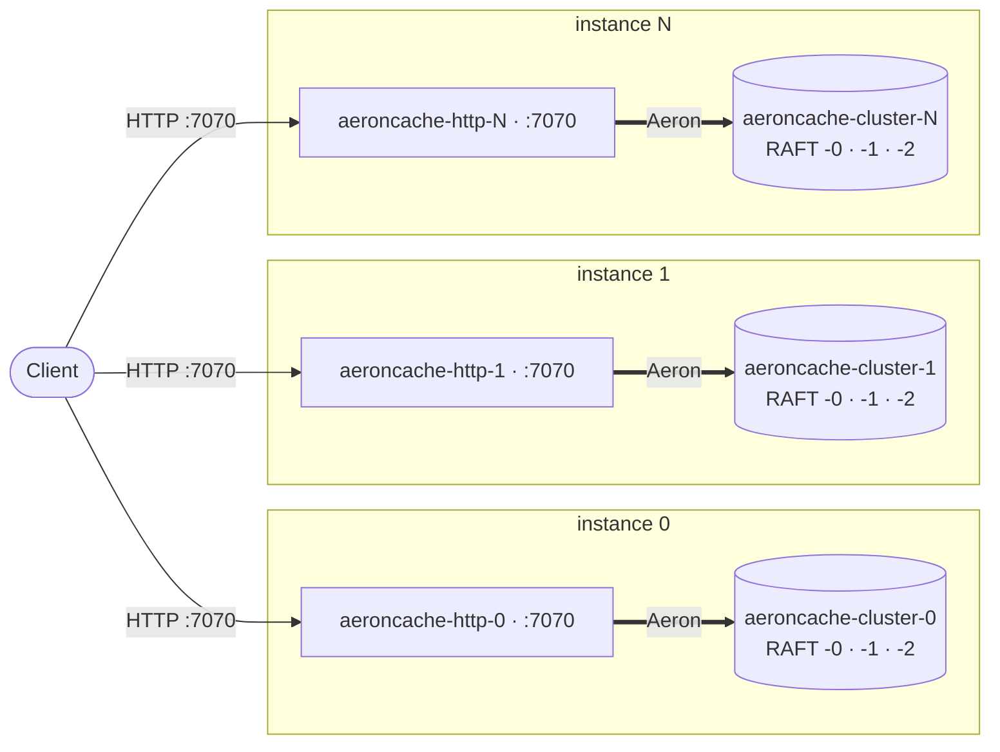

# multi-cache

> Run **N independent cache instances** in one namespace — each its own backend plus its own HTTP
> gateway — so every cache can be verified on its own.

## Overview

Every Aeron Cache interface binds to **exactly one backend** at install time: there is one Aeron
client session from a gateway to one cache. So "many caches" is not one deployment with a dial turned
up — it is **N backend + gateway pairs**, deployed side by side.

This pattern stands up that fan-out. You choose how many caches (`COUNT`) and what kind
(`CACHE_TYPE=clustered|ephemeral`), and it installs one `(backend, http-gateway)` pair per instance,
each pair wired only to itself. Each gateway exists so you can **verify its cache is functioning** —
a create/put/get round-trip per instance.

Reach for this when you want several **isolated** caches at once — per-tenant or per-environment
backends, a blast-radius demo (kill one cache, the others keep serving), or a base to build cache
routing on later. It is **not** a router: there is no shared front door and no sharding of a single
logical cache across backends. Each instance is a complete, independent cache; the client picks which
gateway to talk to. For a single cache behind one interface, use the [http](../http) pattern instead.

## Architecture

`COUNT` independent pairs in one namespace. A gateway talks only to its own backend (Aeron is UDP,
pod-to-pod, headless-addressed); the client picks which gateway to call:



With `CACHE_TYPE=ephemeral` each backend is a single `aeroncache-ephemeral-i` pod (SINGLE mode)
instead of a 3-node RAFT cluster; the wiring is identical.

- **Clustered** instance = one 3-node RAFT cluster (`NODES` to change the node count) + one gateway.
- **Ephemeral** instance = one single-node SINGLE-mode cache + one gateway.

Every release name carries the instance index (`-0`, `-1`, …), so the StatefulSets, Services,
ServiceAccounts and ConfigMaps never collide, and each gateway's `CLUSTER_ADDRESSES` resolves only
its own backend's pods.

## Prerequisites

- A local Kubernetes cluster via **minikube** (the default) — see the [repo README](../../README.md).
- `kubectl`, `helm`, `curl`, `jq`. Run `make doctor` from the repo root to check.
- Enough headroom for the fan-out: each clustered instance is 3 cache pods (+ a clustertools
  sidecar each) plus a gateway. `COUNT=2` clustered is ~8 pods; scale `COUNT`/`NODES` to your cluster.
  Ephemeral instances are far lighter (1 cache pod + 1 gateway each).

## Run

From this directory:

```bash
make up                                 # COUNT=2 clustered caches, each a 3-node RAFT cluster + gateway
make up COUNT=4                         # 4 clustered caches + gateways
make up CACHE_TYPE=ephemeral COUNT=3    # 3 single-node ephemeral caches + gateways
make up COUNT=2 NODES=5                  # clustered, 5 RAFT nodes per cache (NODES is clustered-only)
make verify                             # create/put/get against every gateway in turn
```

To use kind instead (as CI does): `make up CLUSTER=kind`.

## Verify

`make verify` runs [verify-multi.sh](verify-multi.sh): for each instance `i` it port-forwards
`svc/aeroncache-http-i`, creates a cache, puts an item, and asserts it reads back — an independent
round-trip per gateway. A healthy run ends with `ALL <N> CACHE INSTANCES PASSED`. Because each
gateway fronts its own backend, this proves every cache instance is serving on its own.

## Observability (optional)

The shared **Prometheus + Grafana** stack works unchanged — all instances live in one namespace, so
one scrape target set discovers every gateway and clustertools sidecar:

```bash
make up OBSERVABILITY=true
make observability-grafana     # port-forward Grafana -> http://localhost:3000
```

The provisioned dashboard ([dashboards/multi-cache.json](dashboards/multi-cache.json)) is a starter
over the metrics the gateways expose; panels show every instance (filter/group by pod or release).

## Autoscaling (optional)

The gateways are a stateless interface tier, so they can carry a HorizontalPodAutoscaler. `AUTOSCALE=true`
applies it to **every** gateway (never the RAFT/ephemeral backends — their membership is fixed):

```bash
make up AUTOSCALE=true                   # each gateway scales 2..5 at 60% CPU (HPA_MIN/HPA_MAX/HPA_CPU tune it; add HPA_MEM=70 to also scale on memory)
make verify-hpa                          # drive load at gateway 0 and watch its HPA scale up
```

## Near cache (optional)

`NEAR_CACHE=true` enables the server-side near cache on every gateway (composes with `COUNT` /
`CACHE_TYPE` / `AUTOSCALE`). This pattern ships no `verify-near` of its own — confirm it via each
gateway's `/prometheus` near gauges or the [http](../http) pattern's near verify against a single
instance.

## Teardown

```bash
make down            # uninstall every multi-cache release in the namespace (any COUNT)
make cluster-down    # (optional) delete the whole cluster
```

`make down` discovers and removes all `aeroncache-(cluster|ephemeral|http)-<n>` releases, so it
cleans up correctly even if you change `COUNT` between `up` and `down`.

## How it works

The upstream charts are written as **singletons** — one cache, one gateway, fixed names — so two
releases in a namespace would collide. This pattern vendors the same `aeroncache-cluster`,
`aeroncache-ephemeral` and `aeroncache-http` charts as the other patterns, with a few **local edits**
(each marked `multi-cache edit:` in the templates, and listed in [charts/VENDOR.lock](charts/VENDOR.lock))
that parametrise the names the single-instance patterns got to leave constant:

- **Names derive from the release.** `fullnameOverride` and `serviceAccount.name` are blanked so each
  instance's StatefulSet/Service/ServiceAccount take the per-instance release name
  (`aeroncache-cluster-0`, `aeroncache-http-0`, …).
- **ConfigMap names are a value.** The backend/gateway ConfigMap `metadata.name` reads
  `aeroncacheClusterConfigmap` / `aeroncacheHTTPConfigmap`, which the Makefile sets per instance, so
  each release owns its own config (the Deployment reads the same value via `envFrom`).
- **`CLUSTER_ADDRESSES` is derived.** The backend's RAFT peer list is built from its **own** fullname
  and `replicaCount` instead of the one hardcoded `aeroncache-cluster` name — so instance B's nodes
  resolve instance B's peers, and the list tracks `NODES`.
- **The (unused) Secret name derives from the fullname** so it doesn't collide either.

The Makefile then loops `0..COUNT-1`, installing each backend and pointing its gateway's
`clusterAddresses` at that backend's pods. For **ephemeral** instances it also sets each backend's
`ephemeralResponseControlEndpoint` to that instance's own pod FQDN — the node advertises this address
for its Aeron response channel, and the chart default is the singleton name, so without the override
the gateway cannot connect to a renamed instance. Because these are **independent** caches, nothing is
shared between them — no cross-instance consensus, no shared logical cache, no data migration.

> These chart edits are local to this pattern. Re-running `scripts/sync-charts.sh` re-vendors the
> upstream charts and **overwrites** them — re-apply the `multi-cache edit:` changes after a refresh.

## References

- Vendored from upstream charts: [aeron-cache/k8s/helm](https://github.com/bhf/aeron-cache/tree/main/k8s/helm) (pinned SHA in `charts/VENDOR.lock`)
- Single-instance building block: the [http](../http) pattern
- Aeron Cache site: https://aeron-cache.pages.dev
