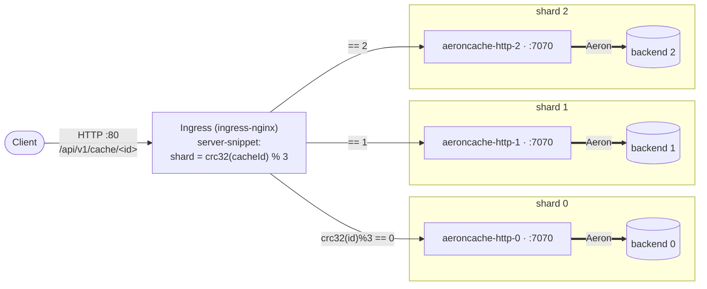

# Routing: Hash (HTTP)

> One front door, **N cache shards behind it** — hash the cache id to a shard, so every operation for
> a given id lands on the same gateway with **no per-id configuration**.

## Overview

[routing-http](../routing-http) routes by cache id with a **static map** you maintain by hand —
`alpha→0, beta→1`, one Ingress path rule per id. That is explicit and auditable, but every new cache
needs a new rule. This pattern removes the map: the Ingress **hashes the cache id** out of the request
path and sends the request to the shard that owns it —

```
shard = crc32(cacheId) % N      ->      aeroncache-http-<shard>   (-> backend <shard>)
```

Any cache id — one you have never seen — routes deterministically to exactly one of **N** shards, and
**all operations for that id** (create, put, get) hash to the same shard, so they share one gateway
and one backend. This is the shape of **sharded / horizontally partitioned** cache routing: the id is
the shard key, the hash spreads ids evenly across shards, and each shard is a complete, isolated cache.

Reach for this when you have **many caches and don't want to enumerate them** — you want capacity to
grow by adding shards, not by editing a route table. If instead you have a small, fixed set of named
caches and want the mapping spelled out at the edge, use [routing-http](../routing-http). The two are
deliberate opposites: explicit map vs. computed shard.

> **Plain mod-N, fixed shards.** `crc32(id) % N` is deterministic but not a consistent hash: changing
> `N` remaps most ids to different shards. That is fine for a fixed-topology demo; elastic resharding
> (a ring, so growing from N to N+1 only moves ~1/N of ids) is a separate concern this pattern does
> not model.

## Architecture



`N` independent `(backend, http gateway)` pairs run in one namespace (the
[multi-cache](../multi-cache) fan-out, `N` = `SHARDS`, default 3). The front door is the first-party
[`common/aeroncache-hash-router`](../../common/aeroncache-hash-router) chart: a single Ingress whose
`nginx.ingress.kubernetes.io/server-snippet` adds one regex location that captures the cache id,
computes `ngx.crc32_long(id) % shardCount` in a `set_by_lua_block`, and `proxy_pass`es the original
request to `aeroncache-http-<shard>`. The chosen shard comes back in the **`X-Aeroncache-Shard`**
response header. With `CACHE_TYPE=ephemeral` each backend is a single SINGLE-mode pod instead of a
3-node RAFT cluster; the wiring is identical.

## Prerequisites

- A local Kubernetes cluster via **minikube** (the default) — see the [repo README](../../README.md).
- `kubectl`, `helm`, `curl`, `jq`. Run `make doctor` from the repo root. (`python3`, if present, is
  used by the verify for an independent hash cross-check; it is optional.)
- An **ingress-nginx controller with snippet annotations enabled** — `make up` installs the controller
  (`INGRESS=true` → [`common/ingress.sh`](../../common/ingress.sh)) **and** turns on snippet
  annotations (`ingress.sh allow-snippets`); you do not need to do either by hand.
- Headroom for `N` backends + `N` gateways (clustered ≈ `N`×4 pods; ephemeral is far lighter). The
  default `SHARDS=3` clustered is ~12 pods — drop to `make up CACHE_TYPE=ephemeral` or `SHARDS=2` on a
  small cluster.

## Run

From this directory:

```bash
make up                          # ingress controller (+snippets) + 3 clustered shards + the hash-router Ingress
make up CACHE_TYPE=ephemeral     # same, single-node ephemeral backends
make up SHARDS=5                 # five shards instead of three
make verify                      # prove deterministic hash sharding (routed + landing + isolation + hash match)
```

To use kind instead (as CI does): add `CLUSTER=kind`.

## Verify

`make verify` ([verify-hash.sh](verify-hash.sh)) port-forwards the ingress controller and every
gateway, writes a spread of cache ids **through the ingress**, and asserts:

1. **Routed round-trip** — each id writes and reads back through the ingress, and the ingress reports
   the shard it picked in the `X-Aeroncache-Shard` header.
2. **Deterministic sharding** — reading each id **directly** from the `N` gateways finds it on
   **exactly one**, and that one is the shard the header named. This is the assertion that rules out
   round-robin / a shared backend.
3. **Non-degenerate** — the id set lands on at least two distinct shards (the default ids exercise all
   three), proving the route is really a hash and not a constant.
4. **Hash match** *(if `python3` is present)* — the owning shard equals `crc32(id) % N` computed
   independently, proving the snippet's hash function itself.

A healthy run ends with `HASH ROUTING VERIFY PASSED`.

### Try it by hand

```bash
kubectl port-forward -n ingress-nginx svc/ingress-nginx-controller 8080:80
curl -X PUT  localhost:8080/api/v1/cache/orders
curl -X POST localhost:8080/api/v1/cache/orders -H 'Content-Type: application/json' -d '{"key":"k","value":"v"}'
curl -i      localhost:8080/api/v1/cache/orders/k     # -> v, with header: X-Aeroncache-Shard: 2
curl -i      localhost:8080/api/v1/cache/anything/k   # any id routes — no 404 for an unmapped id
```

Every id resolves to a shard; there is no such thing as an "unmapped" id here (contrast
[routing-http](../routing-http), where an unlisted id is a 404 at the edge).

## Near cache (optional)

`NEAR_CACHE=true` enables the server-side near cache on **every** gateway (composes with `CACHE_TYPE`),
exactly as in [multi-cache](../multi-cache). This pattern ships no `verify-near` of its own — confirm
it via each gateway's `/prometheus` near gauges (a cold near cache does not give read-after-write, so
the routing verify runs without it).

## Teardown

```bash
make down            # uninstall the hash-router + every backend/gateway release in the namespace
make cluster-down    # (optional) delete the whole cluster
```

(The snippet-annotation setting stays on the shared controller; it is harmless and only affects
Ingresses that carry a snippet.)

## How it works

- **Fan-out, reused.** The deploy loop is the [multi-cache](../multi-cache) loop sized at `SHARDS`:
  each shard is an `aeroncache-cluster-i` (or `aeroncache-ephemeral-i`) backend plus an
  `aeroncache-http-i` gateway wired to that backend only. Release-aware charts keep the shards from
  colliding.
- **The hash runs in the edge.** The Ingress comes from the first-party
  [`common/aeroncache-hash-router`](../../common/aeroncache-hash-router) chart. Its
  `server-snippet` adds a regex location for `/api/v1/cache/<id>` that computes the shard with
  OpenResty's `ngx.crc32_long` (the standard CRC-32, so `zlib.crc32` / `python3 -c 'import zlib'`
  reproduce it) and proxies to the owning gateway. Because the shard is only known per request, the
  `proxy_pass` target is a variable, which is why the chart needs a DNS **resolver** (the Makefile
  discovers the cluster's `kube-dns` ClusterIP and passes it in).
- **Snippets must be allowed.** ingress-nginx disables snippet annotations by default (since v1.9) and
  treats them as `Critical` risk. [`common/ingress.sh allow-snippets`](../../common/ingress.sh) sets
  `allow-snippet-annotations: "true"` + `annotations-risk-level: "Critical"` and restarts the
  controller; `make up` and CI ([prereqs.sh](prereqs.sh)) both call it, so local and CI never drift.
- **The controller is installed on demand.** `INGRESS=true` makes `make up` install ingress-nginx via
  `common/ingress.sh` (a pinned baremetal manifest, reached by port-forward — no addon or node label
  needed). In CI, `prereqs.sh` installs the same controller and enables snippets.

## References

- Front-door chart: [`common/aeroncache-hash-router`](../../common/aeroncache-hash-router)
- Static-map sibling: the [routing-http](../routing-http) pattern · streaming maps: [routing-sse](../routing-sse) · [routing-ws](../routing-ws)
- Controller installer: [`common/ingress.sh`](../../common/ingress.sh)
- Building block: the [multi-cache](../multi-cache) pattern · single cache: [http](../http)
- Vendored from upstream charts: [aeron-cache/k8s/helm](https://github.com/bhf/aeron-cache/tree/main/k8s/helm) (pinned SHA in `charts/VENDOR.lock`)
- Aeron Cache site: https://aeron-cache.pages.dev
