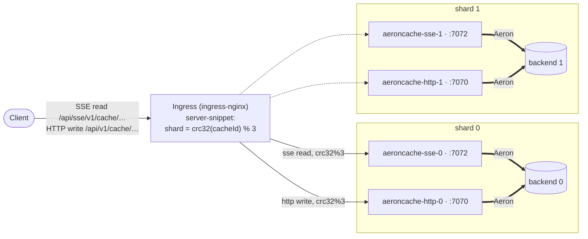

# Routing: Hash (SSE)

> One front door, **N cache shards behind it** — hash the cache id to a shard, read it over a routed
> SSE stream, with **no per-id configuration**. The streaming, unidirectional sibling of
> [routing-hash-http](../routing-hash-http).

## Overview

[routing-sse](../routing-sse) routes SSE subscriptions by cache id with a **static map** you maintain
by hand (`alpha→0, beta→1`, one Ingress rule per id). This pattern removes the map: the Ingress
**hashes the cache id** out of the request path and sends the SSE read to the shard that owns it —

```
read   /api/sse/v1/cache/[hydrate/]<id>  ->  aeroncache-sse-<shard>    (shard = crc32(id) % N)
write  /api/v1/cache/<id>                ->  aeroncache-http-<shard>   (same shard — SSE is read-only)
```

SSE is read-only, so each shard also runs an **http writer**, and writes hash to the writer that shares
the shard's backend. Reads and writes for a given id hash **identically**, so a cache written on shard
*s* is only hydratable from `aeroncache-sse-s`. Any cache id — one you have never seen — routes
deterministically, with no per-id config.

Reach for this when you have **many caches to stream and don't want to enumerate them**. For the
request/response version see [routing-hash-http](../routing-hash-http); for the explicit-map SSE
version see [routing-sse](../routing-sse).

> **Plain mod-N, fixed shards.** `crc32(id) % N` is deterministic but not a consistent hash: changing
> `N` remaps most ids. Fine for a fixed-topology demo; elastic resharding is a separate concern.

## Architecture



`N` independent `(backend, sse reader, http writer)` shards run in one namespace (the
[routing-sse](../routing-sse) fan-out, `N` = `SHARDS`, default 3). The front door is the first-party
[`common/aeroncache-hash-router`](../../common/aeroncache-hash-router) chart with `interface=sse`: its
`server-snippet` adds two regex locations — the SSE read path to `aeroncache-sse-<shard>` (buffering
off, long timeouts), and the write path to `aeroncache-http-<shard>` — both hashing the same id. The
chosen shard comes back in the **`X-Aeroncache-Shard`** response header. `CACHE_TYPE=ephemeral` swaps
each 3-node backend for a single SINGLE-mode pod; the wiring is identical.

## Prerequisites

- A local Kubernetes cluster via **minikube** (the default) — see the [repo README](../../README.md).
- `kubectl`, `helm`, `curl`, `jq`. Run `make doctor`. (`python3`, if present, is used by the verify for
  an independent hash cross-check; it is optional.)
- An **ingress-nginx controller with snippet annotations enabled** — `make up` installs the controller
  (`INGRESS=true` → [`common/ingress.sh`](../../common/ingress.sh)) **and** enables snippets
  (`ingress.sh allow-snippets`); you do not need to do either by hand.
- Headroom for `N` shards, each a backend + sse reader + http writer (clustered ≈ `N`×5 pods; ephemeral
  is far lighter). Default `SHARDS=3` clustered is heavy — use `CACHE_TYPE=ephemeral` or `SHARDS=2` on
  a small cluster.

## Run

```bash
make up                          # ingress controller (+snippets) + 3 clustered shards + the hash-router Ingress
make up CACHE_TYPE=ephemeral     # same, single-node ephemeral backends
make up SHARDS=5                 # five shards
make verify                      # prove deterministic hash sharding over SSE
```

To use kind instead (as CI does): add `CLUSTER=kind`.

## Verify

`make verify` ([verify-hash-sse.sh](verify-hash-sse.sh)) port-forwards the ingress controller and every
sse gateway, writes a spread of cache ids **through the ingress**, and asserts:

1. **Routed round-trip** — each id writes via the ingress http route and reads back over a **routed SSE
   hydrate**; the value streams, and the ingress reports the shard in `X-Aeroncache-Shard`.
2. **Deterministic sharding** — a direct SSE hydrate on the `N` gateways finds each id on **exactly
   one**, and that one is the shard the header named (so the write and the read hashed to the same
   shard's backend).
3. **Non-degenerate** — the id set lands on at least two distinct shards.
4. **Hash match** *(if `python3` is present)* — the owning shard equals `crc32(id) % N` computed
   independently.

A healthy run ends with `HASH ROUTING VERIFY PASSED`.

### Try it by hand

```bash
kubectl port-forward -n ingress-nginx svc/ingress-nginx-controller 8080:80
curl -X PUT  localhost:8080/api/v1/cache/orders
curl -X POST localhost:8080/api/v1/cache/orders -H 'Content-Type: application/json' -d '{"key":"k","value":"v"}'
curl -N      localhost:8080/api/sse/v1/cache/hydrate/orders   # streams {"key":"k","value":"v"} from shard 2
```

## Near cache (optional)

`NEAR_CACHE=true` enables the server-side near cache on **every** gateway (composes with `CACHE_TYPE`),
exactly as in [routing-sse](../routing-sse). This pattern ships no `verify-near` of its own.

## Teardown

```bash
make down            # uninstall the hash-router + every backend/reader/writer release in the namespace
make cluster-down    # (optional) delete the whole cluster
```

## How it works

- **Fan-out, reused.** The deploy loop is the [routing-sse](../routing-sse) loop sized at `SHARDS`: each
  shard is a backend + an `aeroncache-sse-i` reader + an `aeroncache-http-i` writer, all wired to that
  shard's backend. Release-aware charts keep the shards from colliding.
- **The hash runs in the edge.** [`common/aeroncache-hash-router`](../../common/aeroncache-hash-router)
  with `interface=sse` renders a `server-snippet` with two regex locations (sse read → `readRelease`,
  http write → `writeRelease`), both computing `ngx.crc32_long(id) % shardCount` and `proxy_pass`ing to
  the owning gateway. A variable `proxy_pass` needs a DNS **resolver** (the Makefile discovers the
  cluster's `kube-dns` ClusterIP).
- **Snippets must be allowed.** [`common/ingress.sh allow-snippets`](../../common/ingress.sh) turns on
  `allow-snippet-annotations` + `annotations-risk-level: Critical` (both off by default) and restarts
  the controller; `make up` and CI ([prereqs.sh](prereqs.sh)) both call it.

## References

- Front-door chart: [`common/aeroncache-hash-router`](../../common/aeroncache-hash-router)
- Request/response sibling: [routing-hash-http](../routing-hash-http) · static-map SSE: [routing-sse](../routing-sse) · hash WS: [routing-hash-ws](../routing-hash-ws)
- Controller installer: [`common/ingress.sh`](../../common/ingress.sh)
- Building block: [multi-cache](../multi-cache) · single SSE cache: [sse](../sse)
- Vendored from upstream charts: [aeron-cache/k8s/helm](https://github.com/bhf/aeron-cache/tree/main/k8s/helm) (pinned SHA in `charts/VENDOR.lock`)
- Aeron Cache site: https://aeron-cache.pages.dev
