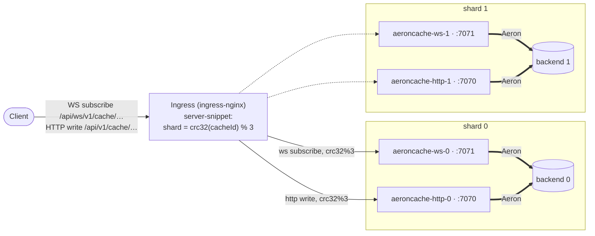

# Routing: Hash (WebSocket)

> One front door, **N cache shards behind it** — hash the cache id to a shard, subscribe over a routed
> WebSocket, with **no per-id configuration**. The streaming, unidirectional sibling of
> [routing-hash-http](../routing-hash-http).

## Overview

[routing-ws](../routing-ws) routes WebSocket subscriptions by cache id with a **static map** you
maintain by hand (`alpha→0, beta→1`). This pattern removes the map: the Ingress **hashes the cache id**
out of the request path and sends the WS subscribe to the shard that owns it —

```
subscribe /api/ws/v1/cache/<id>  ->  aeroncache-ws-<shard>     (shard = crc32(id) % N)
write     /api/v1/cache/<id>     ->  aeroncache-http-<shard>   (same shard — the subscribe is read-only)
```

The WS *subscribe* route carries the cache id in the path and is what gets hashed; the **bidi** endpoint
carries the id in the frame (not the path), so it is intentionally not routed here. Each shard also runs
an **http writer**, and writes hash to the writer that shares the shard's backend. Reads and writes for
a given id hash **identically**, so a cache written on shard *s* is only observable from
`aeroncache-ws-s`. Any cache id routes deterministically, with no per-id config.

Reach for this when you have **many caches to subscribe to and don't want to enumerate them**. For the
request/response version see [routing-hash-http](../routing-hash-http); for the explicit-map WS version
see [routing-ws](../routing-ws).

> **Plain mod-N, fixed shards.** `crc32(id) % N` is deterministic but not a consistent hash: changing
> `N` remaps most ids. Fine for a fixed-topology demo; elastic resharding is a separate concern.

## Architecture



`N` independent `(backend, ws reader, http writer)` shards run in one namespace (the
[routing-ws](../routing-ws) fan-out, `N` = `SHARDS`, default 3). The front door is the first-party
[`common/aeroncache-hash-router`](../../common/aeroncache-hash-router) chart with `interface=ws`: its
`server-snippet` adds two regex locations — the WS subscribe path to `aeroncache-ws-<shard>` (upgrade
carried through, long timeouts), and the write path to `aeroncache-http-<shard>` — both hashing the
same id. `CACHE_TYPE=ephemeral` swaps each 3-node backend for a single SINGLE-mode pod; the wiring is
identical.

## Prerequisites

- A local Kubernetes cluster via **minikube** (the default) — see the [repo README](../../README.md).
- `kubectl`, `helm`, `curl`, `jq`, and **Node 22+** (the verify uses the global `WebSocket`/`fetch`;
  `zlib.crc32`, Node 22.2+, is used for an optional hash cross-check). Run `make doctor`.
- An **ingress-nginx controller with snippet annotations enabled** — `make up` installs the controller
  (`INGRESS=true` → [`common/ingress.sh`](../../common/ingress.sh)) **and** enables snippets
  (`ingress.sh allow-snippets`); you do not need to do either by hand.
- Headroom for `N` shards, each a backend + ws reader + http writer (clustered ≈ `N`×5 pods; ephemeral
  is far lighter). Default `SHARDS=3` clustered is heavy — use `CACHE_TYPE=ephemeral` or `SHARDS=2` on
  a small cluster.

## Run

```bash
make up                          # ingress controller (+snippets) + 3 clustered shards + the hash-router Ingress
make up CACHE_TYPE=ephemeral     # same, single-node ephemeral backends
make up SHARDS=5                 # five shards
make verify                      # prove deterministic hash sharding over WS
```

To use kind instead (as CI does): add `CLUSTER=kind`.

## Verify

`make verify` ([verify-hash-ws.mjs](verify-hash-ws.mjs)) port-forwards the ingress controller and every
http writer, then for a spread of cache ids asserts:

1. **Routed round-trip** — subscribe to each id **through the ingress**, write it through the ingress,
   and see the value pushed to that routed subscription (the subscribe reached the owning ws gateway).
2. **Deterministic sharding** — reading each id **directly** from the `N` http writers finds it on
   **exactly one**, and (if `zlib.crc32` is available) that one is `crc32(id) % N`. Since each ws gateway
   reads only its own backend, 1 + 2 prove the subscribe and the write hashed to the same shard.
3. **Non-degenerate** — the id set lands on at least two distinct shards.

A healthy run ends with `HASH ROUTING VERIFY PASSED`.

> Read isolation is checked over HTTP, not a second WS subscription: a direct WS subscription's
> snapshot/live delivery differs between ephemeral and clustered backends, so a WS-based probe is flaky;
> the backend-level HTTP check is deterministic on both (the same choice as [routing-ws](../routing-ws)).

### Try it by hand

```bash
kubectl port-forward -n ingress-nginx svc/ingress-nginx-controller 8080:80
curl -X PUT  localhost:8080/api/v1/cache/orders
# subscribe (ws): ws://localhost:8080/api/ws/v1/cache/orders   -> routed to aeroncache-ws-2
curl -X POST localhost:8080/api/v1/cache/orders -H 'Content-Type: application/json' -d '{"key":"k","value":"v"}'
```

## Near cache (optional)

`NEAR_CACHE=true` enables the server-side near cache on **every** gateway (composes with `CACHE_TYPE`),
exactly as in [routing-ws](../routing-ws). This pattern ships no `verify-near` of its own.

## Teardown

```bash
make down            # uninstall the hash-router + every backend/reader/writer release in the namespace
make cluster-down    # (optional) delete the whole cluster
```

## How it works

- **Fan-out, reused.** The deploy loop is the [routing-ws](../routing-ws) loop sized at `SHARDS`: each
  shard is a backend + an `aeroncache-ws-i` reader + an `aeroncache-http-i` writer, all wired to that
  shard's backend. Release-aware charts keep the shards from colliding.
- **The hash runs in the edge.** [`common/aeroncache-hash-router`](../../common/aeroncache-hash-router)
  with `interface=ws` renders a `server-snippet` with two regex locations (ws subscribe → `readRelease`
  with the WebSocket upgrade carried through, http write → `writeRelease`), both computing
  `ngx.crc32_long(id) % shardCount` and `proxy_pass`ing to the owning gateway. A variable `proxy_pass`
  needs a DNS **resolver** (the Makefile discovers the cluster's `kube-dns` ClusterIP).
- **Snippets must be allowed.** [`common/ingress.sh allow-snippets`](../../common/ingress.sh) turns on
  `allow-snippet-annotations` + `annotations-risk-level: Critical` (both off by default) and restarts
  the controller; `make up` and CI ([prereqs.sh](prereqs.sh)) both call it.

## References

- Front-door chart: [`common/aeroncache-hash-router`](../../common/aeroncache-hash-router)
- Request/response sibling: [routing-hash-http](../routing-hash-http) · static-map WS: [routing-ws](../routing-ws) · hash SSE: [routing-hash-sse](../routing-hash-sse)
- Controller installer: [`common/ingress.sh`](../../common/ingress.sh)
- Building block: [multi-cache](../multi-cache) · single WS cache: [ws](../ws)
- Vendored from upstream charts: [aeron-cache/k8s/helm](https://github.com/bhf/aeron-cache/tree/main/k8s/helm) (pinned SHA in `charts/VENDOR.lock`)
- Aeron Cache site: https://aeron-cache.pages.dev
