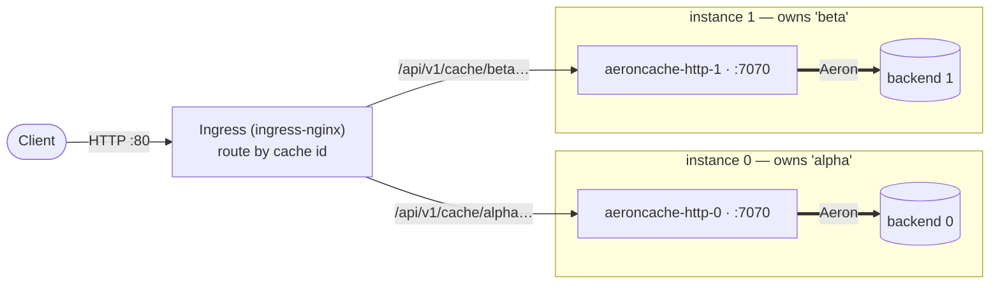

# Routing: HTTP

> One front door, **N caches behind it** — route each request to the http gateway that owns the cache
> named in its path.

## Overview

The [multi-cache](../multi-cache) pattern stands up several independent caches side by side but leaves
the client to pick which gateway to call. This pattern adds the missing **front door**: a single
Ingress that reads the **cache id from the request path** and forwards to the gateway (and backend)
that owns it.

Two independent `(backend, http gateway)` pairs run in one namespace. Cache **`alpha`** lives on
instance 0, cache **`beta`** on instance 1. A client talks only to the Ingress and addresses caches by
id — `/api/v1/cache/alpha/...` lands on instance 0, `/api/v1/cache/beta/...` on instance 1. This is
the shape of realistic **per-tenant / sharded** cache routing: the id is the routing key, and each
backend is a complete, isolated cache.

Reach for this when you want many isolated caches behind one address, with the mapping from cache id
to backend made explicit at the edge. For the streaming interfaces, see
[routing-sse](../routing-sse) and [routing-ws](../routing-ws) — the same id-in-the-path routing, for
unidirectional streams.

## Architecture



The Ingress is rendered by the shared [`common/aeroncache-router`](../../common/aeroncache-router)
chart: one path rule per cache id (`/api/v1/cache/<id>(/|$)(.*)`, matched with
`nginx.ingress.kubernetes.io/use-regex`) pointing at `aeroncache-http-<instance>`. A cache id that is
not mapped has no matching path and returns **404** at the Ingress — routing is explicit, never
round-robin. With `CACHE_TYPE=ephemeral` each backend is a single SINGLE-mode pod instead of a 3-node
RAFT cluster; the wiring is identical.

## Prerequisites

- A local Kubernetes cluster via **minikube** (the default) — see the [repo README](../../README.md).
- `kubectl`, `helm`, `curl`, `jq`. Run `make doctor` from the repo root.
- An **ingress-nginx controller** — `make up` installs one automatically (`INGRESS=true` →
  [`common/ingress.sh`](../../common/ingress.sh)); you do not need to install it yourself.
- Headroom for two backends + two gateways (clustered ≈ 8 pods; ephemeral is far lighter).

## Run

From this directory:

```bash
make up                       # ingress controller + 2 clustered caches + gateways + the router Ingress
make up CACHE_TYPE=ephemeral  # same, single-node ephemeral backends
make verify                   # prove routing by cache id (routed round-trip + landing + isolation)
```

To use kind instead (as CI does): add `CLUSTER=kind`.

## Verify

`make verify` ([verify-routing.sh](verify-routing.sh)) port-forwards the ingress controller and both
gateways, then asserts:

1. **Routed round-trip** — write and read `alpha` and `beta` **through the ingress**; each returns its
   own value.
2. **Correct landing** — read each cache **directly** from its owning gateway.
3. **Isolation** — the *other* gateway never received it (`alpha` is absent on instance 1, `beta` on
   instance 0). This is the assertion that proves the ingress routed by the cache id rather than
   spraying requests across backends.

A healthy run ends with `ROUTING VERIFY PASSED`.

### Try it by hand

```bash
kubectl port-forward -n ingress-nginx svc/ingress-nginx-controller 8080:80
curl -X PUT  localhost:8080/api/v1/cache/alpha
curl -X POST localhost:8080/api/v1/cache/alpha -H 'Content-Type: application/json' -d '{"key":"k","value":"v"}'
curl        localhost:8080/api/v1/cache/alpha/k     # -> v  (served by instance 0)
curl -i     localhost:8080/api/v1/cache/unmapped/k  # -> 404 at the ingress (no route for this id)
```

## Near cache (optional)

`NEAR_CACHE=true` enables the server-side near cache on **every** gateway (composes with `CACHE_TYPE`),
exactly as in [multi-cache](../multi-cache). This pattern ships no `verify-near` of its own — confirm
it via each gateway's `/prometheus` near gauges (a cold near cache does not give read-after-write, so
the routing verify runs without it).

## Teardown

```bash
make down            # uninstall the router + every backend/gateway release in the namespace
make cluster-down    # (optional) delete the whole cluster
```

## How it works

- **Fan-out, reused.** The deploy loop is the [multi-cache](../multi-cache) loop fixed at two
  instances: each instance is an `aeroncache-cluster-i` (or `aeroncache-ephemeral-i`) backend plus an
  `aeroncache-http-i` gateway wired to that backend only. Release-aware charts keep the pairs from
  colliding.
- **The front door is shared.** The Ingress comes from the first-party
  [`common/aeroncache-router`](../../common/aeroncache-router) chart (like `common/observability`, it
  is not a vendored upstream chart). The Makefile installs it with `interface=http` and the route map
  `alpha→0, beta→1`.
- **The controller is installed on demand.** `INGRESS=true` makes `make up` install ingress-nginx via
  `common/ingress.sh` (a pinned baremetal manifest, reached by port-forward — no addon or node label
  needed). In CI, [`prereqs.sh`](prereqs.sh) installs the same controller.

## References

- Front-door chart: [`common/aeroncache-router`](../../common/aeroncache-router)
- Controller installer: [`common/ingress.sh`](../../common/ingress.sh)
- Building block: the [multi-cache](../multi-cache) pattern · single cache: [http](../http)
- Streaming variants: [routing-sse](../routing-sse) · [routing-ws](../routing-ws)
- Vendored from upstream charts: [aeron-cache/k8s/helm](https://github.com/bhf/aeron-cache/tree/main/k8s/helm) (pinned SHA in `charts/VENDOR.lock`)
- Aeron Cache site: https://aeron-cache.pages.dev
