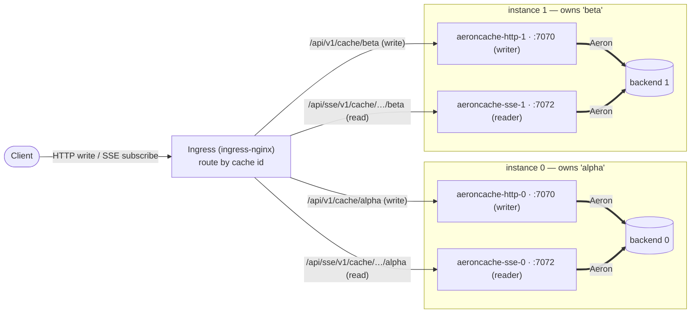

# Routing: SSE

> Route by cache id to the **streaming** gateway that owns the cache — the same id-in-the-path routing
> as [routing-http](../routing-http), proven for a unidirectional SSE stream.

## Overview

This is the Server-Sent Events variant of [routing-http](../routing-http). Two independent caches run
behind one Ingress; the **cache id in the subscription path** selects the SSE gateway that owns it:

- `/api/sse/v1/cache/hydrate/alpha` streams from instance 0 (`aeroncache-sse-0`)
- `/api/sse/v1/cache/hydrate/beta` streams from instance 1 (`aeroncache-sse-1`)

SSE is **read-only** — there is no way to create caches or write items over it — so each instance also
runs an `aeroncache-http` **writer**, and writes are routed by the **same cache id** to the writer that
shares the backend (`/api/v1/cache/alpha` → `aeroncache-http-0`). The point of the pattern: routing by
cache id works end-to-end for a streaming interface, not just request/response.

## Architecture



The Ingress is rendered by the shared [`common/aeroncache-router`](../../common/aeroncache-router)
chart with `interface=sse`: a read rule per cache id to the sse gateway
(`/api/sse/v1/cache/(hydrate/)?<id>…` → `aeroncache-sse-<i>:7072`) plus a write rule to the http writer
(`/api/v1/cache/<id>…` → `aeroncache-http-<i>:7070`). The Ingress carries
`nginx.ingress.kubernetes.io/proxy-buffering: "off"` and a long read timeout so the event stream is not
buffered or cut off. `CACHE_TYPE=ephemeral` swaps each 3-node backend for a single SINGLE-mode pod.

## Prerequisites

- A local Kubernetes cluster via **minikube** (the default) — see the [repo README](../../README.md).
- `kubectl`, `helm`, `curl`, `jq`. Run `make doctor`.
- An **ingress-nginx controller** — `make up` installs one automatically
  ([`common/ingress.sh`](../../common/ingress.sh)).
- Headroom for two backends + two sse readers + two http writers.

## Run

```bash
make up                       # ingress controller + 2 (backend + sse + http writer) + the router Ingress
make up CACHE_TYPE=ephemeral  # same, single-node ephemeral backends
make verify                   # prove routing by cache id over SSE (routed round-trip + landing + isolation)
```

To use kind instead (as CI does): add `CLUSTER=kind`.

## Verify

`make verify` ([verify-routing-sse.sh](verify-routing-sse.sh)) port-forwards the ingress controller and
both sse gateways, then asserts:

1. **Routed round-trip** — write `alpha`/`beta` through the ingress (the http write route), then read
   each back over a **routed SSE hydrate subscription**; the value streams through.
2. **Correct landing** — a direct SSE hydrate on the owning sse gateway returns the value.
3. **Isolation** — a direct SSE hydrate on the *other* sse gateway does not (the value never reached
   that backend) — proving the stream was routed by cache id.

A healthy run ends with `ROUTING VERIFY PASSED`.

### Try it by hand

```bash
kubectl port-forward -n ingress-nginx svc/ingress-nginx-controller 8080:80
curl -X PUT  localhost:8080/api/v1/cache/alpha                        # write via the routed http writer
curl -X POST localhost:8080/api/v1/cache/alpha -H 'Content-Type: application/json' -d '{"key":"k","value":"v"}'
curl -N      localhost:8080/api/sse/v1/cache/hydrate/alpha            # read via the routed sse gateway
```

## Near cache (optional)

`NEAR_CACHE=true` enables the server-side near cache on every sse and http interface (composes with
`CACHE_TYPE`). As in [multi-cache](../multi-cache), this pattern ships no `verify-near`; confirm it via
each sse gateway's `/prometheus` near gauges.

## Teardown

```bash
make down            # uninstall the router + every routing-sse release in the namespace
make cluster-down    # (optional) delete the whole cluster
```

## How it works

- **Fan-out, reused.** The deploy loop installs, per instance, an `aeroncache-cluster-i` (or
  `-ephemeral-i`) backend, an `aeroncache-sse-i` reader, and an `aeroncache-http-i` writer — the reader
  and writer wired to the same backend (`clusterAddresses` / ephemeral endpoints applied to both), the
  [sse](../sse) pattern's writer-alongside shape, fanned out two ways. The upstream `aeroncache-sse` chart
  is release-aware (like the http/cluster charts), so each release's resource names derive from its release
  name and the gateway fans out across `aeroncache-sse-0`, `aeroncache-sse-1`, … without colliding.
- **One Ingress, two rule kinds.** The shared [`common/aeroncache-router`](../../common/aeroncache-router)
  chart emits both the sse read rule and the http write rule per cache id, with the SSE-specific nginx
  annotations.
- **Controller on demand.** `INGRESS=true` makes `make up` install ingress-nginx via
  `common/ingress.sh`; in CI [`prereqs.sh`](prereqs.sh) installs the same controller.

## References

- Front-door chart: [`common/aeroncache-router`](../../common/aeroncache-router) · controller installer: [`common/ingress.sh`](../../common/ingress.sh)
- Building blocks: [multi-cache](../multi-cache) · [sse](../sse) · sibling: [routing-http](../routing-http) · [routing-ws](../routing-ws)
- [SSE OpenAPI](https://github.com/bhf/aeron-cache/blob/main/cache-sse/sse-openapi.yaml)
- Vendored from [aeron-cache/k8s/helm](https://github.com/bhf/aeron-cache/tree/main/k8s/helm) (pinned SHA in `charts/VENDOR.lock`)
- Aeron Cache site: https://aeron-cache.pages.dev
