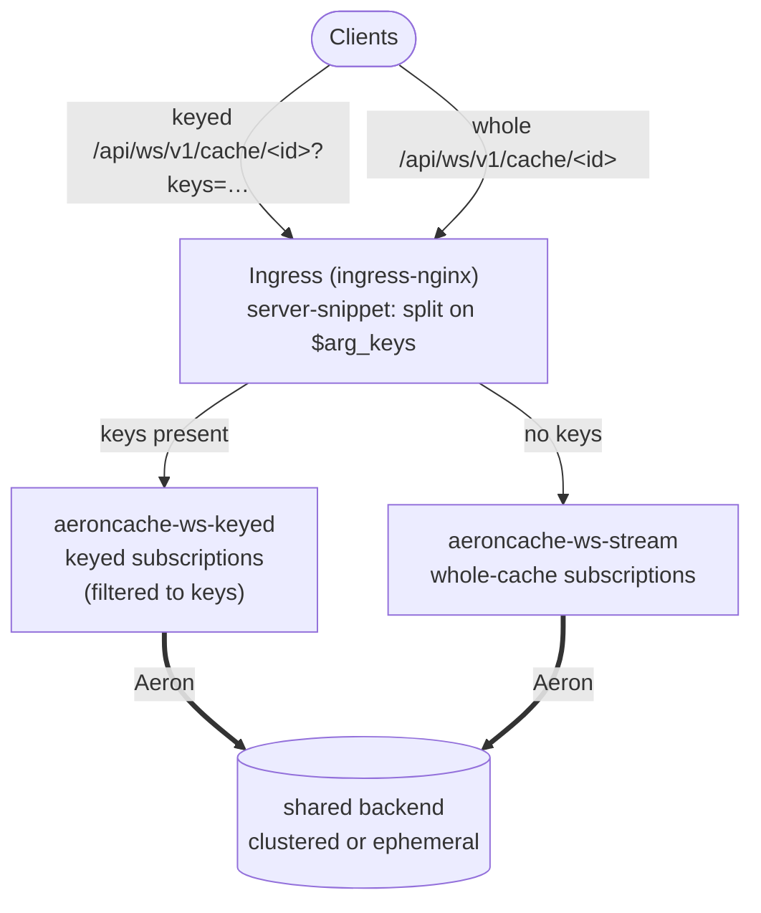

# Routing: WebSocket keyed vs whole-cache

> Split the WebSocket **subscribe** endpoint across two gateways behind one Ingress by whether the
> subscription is **keyed** — keyed subscriptions (`?keys=…`) to one gateway, whole-cache unidirectional
> streaming subscriptions (no `keys`) to another — both over **one shared backend**. Like
> [routing-ws-split](../routing-ws-split) it separates one ws interface's traffic across two gateways,
> but the thing it routes on is a **query parameter**, not the path.

## Overview

A WebSocket subscription to a cache can be **keyed** or **whole-cache**:

- **keyed** — `ws://…/api/ws/v1/cache/<id>?keys=<key>` restricts the stream to specific keys (the
  `keys` filter is comma-separated `cacheId:key` or bare `key` tokens). The gateway filters server-side
  and pushes updates **only** for the subscribed keys.
- **whole-cache** — `ws://…/api/ws/v1/cache/<id>` (no `keys`) streams updates for **every** key in the
  cache.

The two differ **only by the `keys` query parameter** — same path, same method. Their load profiles
differ, though: a keyed subscription is a narrow, per-key fan-out (often many of them, one per watched
entity), while a whole-cache subscription is a broad firehose. This pattern runs them on **two separate
gateways** over **one shared backend** so they scale, tune and fail independently.

Because the distinction is in the **query string, not the path**, the front door can't split them with
a path rule — ingress path matching ignores the query string. So, unlike
[routing-ws-split](../routing-ws-split)'s clean path prefixes, the split is decided inside an
**nginx `server-snippet`** that inspects `$arg_keys` and proxies to the chosen gateway:

```
keyed      /api/ws/v1/cache/<id>?keys=<key>  ->  aeroncache-ws-keyed    (filtered to those keys)
whole-cache /api/ws/v1/cache/<id>            ->  aeroncache-ws-stream   (entire cache)
```

That is the same snippet mechanism (a variable `proxy_pass` resolved per request) the
[hash-routing patterns](../routing-hash-ws) use, so the controller must **allow snippet annotations**
(`common/ingress.sh allow-snippets`) — `make up` and CI do this for you.

```
routing-ws-split : route by ENDPOINT path   (bidi vs streaming)   — disjoint prefixes, no snippet
routing-ws-keyed : route by QUERY PARAMETER (keyed vs whole)      — server-snippet on $arg_keys
```

Reach for this when keyed, per-entity watchers and broad whole-cache streams should not share a
gateway — e.g. so a flood of fine-grained keyed subscriptions can't crowd out the whole-cache
consumers (or vice versa), and each tier scales on its own.

## Architecture



One shared backend feeds both gateways. The front door is the first-party
[`common/aeroncache-ws-keyed-router`](../../common/aeroncache-ws-keyed-router) chart: a single Ingress
whose `server-snippet` adds one regex location over the subscribe routes, reads `$arg_keys`, and
proxies to the keyed Service when `keys` is non-empty or the stream Service otherwise, carrying the
WebSocket upgrade and the original query string through. `CACHE_TYPE=ephemeral` swaps the 3-node backend
for a single SINGLE-mode pod; the split wiring is identical.

> **Why a snippet and not a path rule?** A keyed subscription is the same URL **path** as a whole-cache
> one — only the `keys` query parameter differs, and a Kubernetes Ingress path can't match on the query
> string. Routing on it therefore has to happen in nginx, where `$arg_keys` is available. (The
> [bidi endpoint](../routing-ws-split) is likewise unroutable by id because the id is in the frame — a
> recurring theme: not everything you want to route on is in the path.)

## Prerequisites

- A local Kubernetes cluster via **minikube** (the default) — see the [repo README](../../README.md).
- `kubectl`, `helm`, `curl`, `jq`, and **Node 22+** (the verify uses the global `WebSocket`/`fetch`).
  Run `make doctor`.
- An **ingress-nginx controller with snippet annotations enabled** — `make up` installs it
  (`INGRESS=true`) and `make deploy` runs `common/ingress.sh allow-snippets`; CI does both from
  [`prereqs.sh`](prereqs.sh).
- Headroom for the shared backend + two ws gateways. Clustered ≈ `NODES + 2` pods; ephemeral is far
  lighter (`1 + 2`).

## Run

```bash
make up                          # ingress controller (+ snippets) + shared clustered backend + both gateways
make up CACHE_TYPE=ephemeral     # same, single-node ephemeral backend
make verify                      # prove the split: keyed sub->keyed gw, whole-cache sub->stream gw, shared backend
```

To use kind instead (as CI does): add `CLUSTER=kind`.

## Verify

`make verify` ([verify-ws-keyed.mjs](verify-ws-keyed.mjs)) port-forwards the ingress controller and
**both** gateway Services, then drives everything **through the ingress**. Both gateways run the same
image, so "does the subscription work" can't tell them apart — only *where the ingress sent it* differs,
so each landing is proven with the per-gateway `aeroncache_subscriptions_active` gauge:

1. **keyed → keyed gateway** — a `?keys=` subscription raises `subscriptions_active` on the **keyed**
   gateway and not on the stream gateway.
2. **whole-cache → stream gateway** — a no-keys subscription raises `subscriptions_active` on the
   **stream** gateway and not on the keyed gateway.
3. **Keyed filtering + shared backend** — with both subscriptions open, three keys are written over one
   gateway's bidi socket. The keyed subscription (`keys=keyA`) receives **only** `keyA`; the whole-cache
   subscription receives `keyB` and `keyC` too. The whole-cache subscription lives on the stream gateway
   while the write went in on the keyed gateway, so one shared backend feeds both.

A healthy run ends with `WS KEYED VERIFY PASSED`.

### Try it by hand

```bash
kubectl port-forward -n ingress-nginx svc/ingress-nginx-controller 8080:80 &
# keyed subscription (-> keyed gateway), Node 22+:
#   new WebSocket('ws://localhost:8080/api/ws/v1/cache/orders?keys=order-42')
# whole-cache subscription (-> stream gateway):
#   new WebSocket('ws://localhost:8080/api/ws/v1/cache/orders')
# the chosen gateway class comes back in the X-Aeroncache-Sub-Type response header
```

## Near cache (optional)

`NEAR_CACHE=true` enables the server-side near cache on **both** gateways (composes with `CACHE_TYPE`).
This pattern ships no `verify-near`; confirm it via each gateway's `/prometheus` near gauges
(`aeroncache_near_warm_caches{domain="cache"}`) after priming (`POST /api/v1/near/cache/<id>`).

## Observability (optional)

Add a **Prometheus + Grafana** stack that scrapes this pattern and ships a Grafana dashboard for it:

```bash
make up OBSERVABILITY=true        # deploy the pattern + Prometheus + Grafana
make observability-grafana        # port-forward Grafana -> http://localhost:3000
```

`OBSERVABILITY=true` installs the shared chart (`../../common/observability`) and provisions this
pattern's dashboard (`dashboards/routing-ws-keyed.json`, Grafana folder **Aeron Cache Patterns**). Its
panels split the active-subscriptions and operations gauges **by gateway**, so you can watch keyed
subscriptions sit on the keyed gateway and whole-cache subscriptions on the stream gateway. It composes
with `CACHE_TYPE`.

## Teardown

```bash
make down            # uninstall the keyed-router + both gateways + backend
make cluster-down    # (optional) delete the whole cluster
```

## How it works

- **Two gateways, one backend.** `aeroncache-ws` is installed twice — `aeroncache-ws-keyed` and
  `aeroncache-ws-stream` — both wired to the single shared backend. The upstream chart is release-aware,
  so each release's resource names derive from its release name and the two gateways' Services don't
  collide.
- **The split runs in nginx.** [`common/aeroncache-ws-keyed-router`](../../common/aeroncache-ws-keyed-router)
  renders one Ingress whose `server-snippet` adds a regex location over the subscribe routes; a
  `set_by_lua_block` reads `$arg_keys` and picks the upstream Service (keyed when non-empty, stream
  otherwise), then `proxy_pass`es the original URI — query string and all — to it. The variable
  `proxy_pass` needs a `resolver`, which the Makefile discovers from `kube-dns` at deploy time.
- **Snippets must be allowed.** Because the routing is a server-snippet, the controller needs
  `allow-snippet-annotations` (`common/ingress.sh allow-snippets`), exactly like the hash-routing
  patterns. Without it the snippet is dropped and everything falls through to the default backend.

## References

- Front-door chart: [`common/aeroncache-ws-keyed-router`](../../common/aeroncache-ws-keyed-router)
- Sibling split: [routing-ws-split](../routing-ws-split) (route by endpoint path) · snippet routing: [routing-hash-ws](../routing-hash-ws)
- [WebSocket subscribe API (`keys` / `mode` params)](https://github.com/bhf/aeron-cache/blob/main/cache-ws/ws-openapi.yaml) · controller installer: [`common/ingress.sh`](../../common/ingress.sh)
- Vendored from [aeron-cache/k8s/helm](https://github.com/bhf/aeron-cache/tree/main/k8s/helm) (`aeroncache-cluster`, `aeroncache-ephemeral`, `aeroncache-ws`; pinned SHA in `charts/VENDOR.lock`)
- Aeron Cache site: https://aeron-cache.pages.dev
