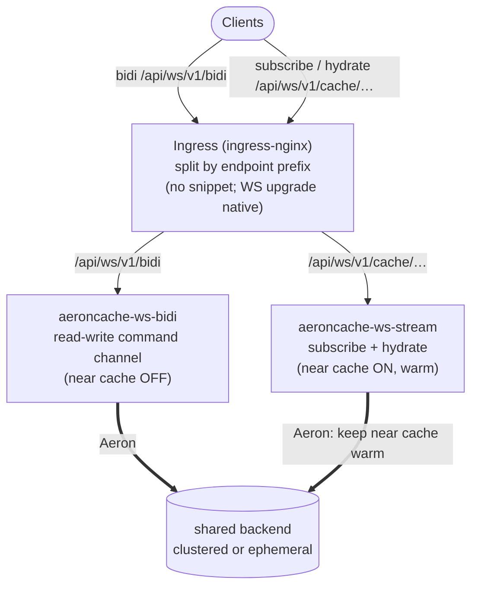

# Routing: WebSocket by connection type

> Split **one** WebSocket interface by **endpoint role** across two gateways behind one Ingress —
> **bidi** (read-write command) connections to one gateway, **unidirectional streaming** (subscribe,
> with or without hydration) to another — both over **one shared backend**. A different routing
> dimension from [routing-ws](../routing-ws) (route by cache id) and [hydration-lb](../hydration-lb)
> (round-robin a pool): here the **endpoint**, not the id, picks the gateway.

## Overview

The WebSocket interface exposes two very different kinds of endpoint:

- **bidi** — `ws://…/api/ws/v1/bidi` is the read-write **command channel**: a request/response RPC
  stream (`CREATE_CACHE`, `ADD_CACHE_ENTRY`, `GET_CACHE_ENTRY`). The cache id travels **in the JSON
  frame**, not the URL.
- **unidirectional streaming** — `ws://…/api/ws/v1/cache/<id>` streams future updates, and
  `ws://…/api/ws/v1/cache/hydrate/<id>` additionally pushes a point-in-time **snapshot** (one
  `ADD_ITEM` frame per existing item) before the live stream. These are read-only fan-out, and the
  hydration snapshot is the expensive part.

Those two workloads have opposite shapes — mutating RPC versus read-only fan-out and snapshot
hydration — so this pattern runs them on **two separate gateways** over **one shared backend** and
splits the traffic at the front door by **endpoint path**:

```
bidi      /api/ws/v1/bidi               ->  aeroncache-ws-bidi    (read-write command channel)
subscribe /api/ws/v1/cache/<id>         ->  aeroncache-ws-stream  (future updates)
hydrate   /api/ws/v1/cache/hydrate/<id> ->  aeroncache-ws-stream  (snapshot first, then updates)
```

The two endpoints have **disjoint static path prefixes** (`/api/ws/v1/bidi` vs `/api/ws/v1/cache`),
so the split needs **no cache-id regex and no Lua server-snippet** — ingress-nginx matches the longest
prefix and upgrades the WebSocket natively. Because both gateways share one backend, a write over the
bidi gateway is immediately visible to a subscription on the stream gateway.

```
routing-ws       : route by cache id      ->  the gateway that OWNS that cache   (partition caches)
hydration-lb     : round-robin a pool     ->  ANY warm gateway serves any id     (replicate caches)
routing-ws-split : route by ENDPOINT role ->  bidi gw vs stream gw, one backend  (separate workloads)
```

Reach for this when the **command/write path** and the **streaming/hydration path** want to scale,
be tuned, and fail **independently** — e.g. so a burst of expensive snapshot hydrations on the stream
gateway cannot starve the bidi command path, and the stream gateway can run the **near cache** (warm
hydration) while the bidi writer does not need it.

## Architecture



One shared backend feeds both gateways. The front door is the first-party
[`common/aeroncache-ws-split-router`](../../common/aeroncache-ws-split-router) chart: a single Ingress
with two prefix rules (bidi → the bidi Service, `/api/ws/v1/cache` → the stream Service), a long
read/send timeout so a quiet long-lived stream is not closed, and **no `server-snippet`, so no
`allow-snippets`** (unlike the [hash-routing patterns](../routing-hash-ws)). `CACHE_TYPE=ephemeral`
swaps the 3-node backend for a single SINGLE-mode pod; the split wiring is identical.

> **Why not route the bidi endpoint by cache id too?** It can't be: bidi carries the cache id **in the
> frame**, not the URL, so the front door can't see the id until the socket is already open to one
> backend. That is exactly why [routing-ws](../routing-ws) routes only the uni-directional *subscribe*
> path. This pattern doesn't need the id — it routes the **endpoint**, which is in the URL for both.

## Prerequisites

- A local Kubernetes cluster via **minikube** (the default) — see the [repo README](../../README.md).
- `kubectl`, `helm`, `curl`, `jq`, and **Node 22+** (the verify uses the global `WebSocket`/`fetch`).
  Run `make doctor`.
- An **ingress-nginx controller** — `make up` installs it (`INGRESS=true` →
  [`common/ingress.sh`](../../common/ingress.sh)). Snippet annotations are **not** required.
- Headroom for the shared backend + two ws gateways. Clustered ≈ `NODES + 2` pods; ephemeral is far
  lighter (`1 + 2`).

## Run

```bash
make up                          # ingress controller + shared clustered backend + bidi + stream gateways
make up CACHE_TYPE=ephemeral     # same, single-node ephemeral backend
make verify                      # prove the split: bidi->bidi gw, subscribe/hydrate->stream gw, shared backend
```

To use kind instead (as CI does): add `CLUSTER=kind`.

## Verify

`make verify` ([verify-ws-split.mjs](verify-ws-split.mjs)) port-forwards the ingress controller and
**both** gateway Services, then drives everything **through the ingress**. Both gateways run the same
image, so "does the endpoint work" can't tell them apart — only *where the ingress sent it* differs, so
each landing is proven with a **per-gateway metric** on that gateway's own `/prometheus`:

1. **bidi → bidi gateway** — seed the cache over the ingress bidi endpoint; `aeroncache_operations_total`
   rises on the **bidi** gateway and not on the stream gateway.
2. **subscribe → stream gateway** — open a subscription over the ingress;
   `aeroncache_subscriptions_active` rises on the **stream** gateway and not on the bidi gateway.
3. **Shared backend** — with that subscription open, write a fresh value over the **bidi** socket and
   see it pushed to the subscription on the **stream** gateway, proving one backend behind the two.
4. **hydrate → stream gateway (served warm)** — prime the stream gateway's near cache, then open `M`
   hydrating subscriptions over the ingress; each receives its snapshot, and
   `aeroncache_near_hydrations_served_total` rises on the **stream** gateway by exactly `M` (served
   warm) while the bidi gateway serves `0` (its near cache is off).

A healthy run ends with `WS SPLIT VERIFY PASSED`.

### Try it by hand

```bash
kubectl port-forward -n ingress-nginx svc/ingress-nginx-controller 8080:80 &
# bidi (read-write), Node 22+:
#   const ws = new WebSocket('ws://localhost:8080/api/ws/v1/bidi')
#   ws.send(JSON.stringify({type:'command',op:'CREATE_CACHE',correlationId:'c',cacheId:'orders'}))
# subscribe (stream gateway):  ws://localhost:8080/api/ws/v1/cache/orders
# hydrate   (stream gateway):  ws://localhost:8080/api/ws/v1/cache/hydrate/orders
```

## Near cache

The near cache is **on for the stream gateway only** — that is the point of the split: hydration is
served warm from the stream gateway's local copy, isolated from the bidi command path (whose gateway
keeps the near cache off). The stream gateway publishes the near-cache metrics on its own `/prometheus`
(`aeroncache_near_warm_caches{domain="cache"}` and `aeroncache_near_hydrations_served_total`), and the
management API lists what is warm:

```bash
kubectl port-forward -n aeroncache-patterns svc/aeroncache-ws-stream 7071:7071 &
curl -s localhost:7071/api/v1/near/caches | jq .     # warm caches + local item counts
curl -s localhost:7071/prometheus | grep near        # the near-cache gauges/counter
```

## Observability (optional)

Add a **Prometheus + Grafana** stack that scrapes this pattern and ships a Grafana dashboard for it:

```bash
make up OBSERVABILITY=true        # deploy the pattern + Prometheus + Grafana
make observability-grafana        # port-forward Grafana -> http://localhost:3000
```

`OBSERVABILITY=true` installs the shared chart (`../../common/observability`) and provisions this
pattern's dashboard (`dashboards/routing-ws-split.json`, Grafana folder **Aeron Cache Patterns**). Its
panels split the operations, active-subscriptions, hydrations-served and near-cache gauges **by
gateway**, so you can watch the command load sit on the bidi gateway and the streaming/hydration load
sit on the stream gateway. It composes with `CACHE_TYPE`.

## Teardown

```bash
make down            # uninstall the split-router + both gateways + backend
make cluster-down    # (optional) delete the whole cluster
```

## How it works

- **Two gateways, one backend.** `aeroncache-ws` is installed twice — `aeroncache-ws-bidi` (near cache
  off) and `aeroncache-ws-stream` (near cache on) — both wired to the single shared backend. The
  upstream chart is release-aware, so each release's resource names derive from its release name and
  the two gateways' Services don't collide.
- **The split is prefix routing at the edge.**
  [`common/aeroncache-ws-split-router`](../../common/aeroncache-ws-split-router) is a single Ingress
  with two `pathType: Prefix` rules. The prefixes are disjoint, so ingress-nginx's longest-prefix match
  sends `/api/ws/v1/bidi` to the bidi gateway and both `/api/ws/v1/cache/<id>` and
  `/api/ws/v1/cache/hydrate/<id>` to the stream gateway — no regex, no snippet, no `allow-snippets`.
- **bidi can only be routed by endpoint.** The bidi endpoint carries the cache id in the frame, so it
  is not routable by id; routing by endpoint is what makes separating it possible.

## References

- Front-door chart: [`common/aeroncache-ws-split-router`](../../common/aeroncache-ws-split-router)
- Related: [routing-ws](../routing-ws) (route by cache id) · [hydration-lb](../hydration-lb) (warm pool) · [ws](../ws) (single gateway, bidi + unidi)
- [Bidi WebSocket OpenAPI](https://github.com/bhf/aeron-cache/blob/main/cache-ws/bidi-ws-openapi.yaml)
- Controller installer: [`common/ingress.sh`](../../common/ingress.sh)
- Vendored from [aeron-cache/k8s/helm](https://github.com/bhf/aeron-cache/tree/main/k8s/helm) (`aeroncache-cluster`, `aeroncache-ephemeral`, `aeroncache-ws`; pinned SHA in `charts/VENDOR.lock`)
- Aeron Cache site: https://aeron-cache.pages.dev
