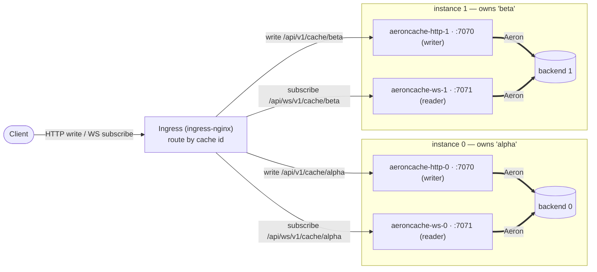

# Routing: WebSocket

> Route by cache id to the **WebSocket** gateway that owns the cache — the same id-in-the-path routing
> as [routing-http](../routing-http), proven for a unidirectional WebSocket subscription.

## Overview

This is the WebSocket variant of [routing-http](../routing-http). Two independent caches run behind one
Ingress; the **cache id in the subscribe path** selects the ws gateway that owns it:

- `ws://…/api/ws/v1/cache/alpha` streams from instance 0 (`aeroncache-ws-0`)
- `ws://…/api/ws/v1/cache/beta` streams from instance 1 (`aeroncache-ws-1`)

The ws interface's **bidi** endpoint (`/api/ws/v1/bidi`) carries the cache id **in the JSON frame, not
the URL**, so it cannot be routed by path — a front door can't see the id until the socket is already
open to one backend. This pattern therefore routes the **uni-directional subscribe** route, where the id
is in the path. Those subscriptions are read-only, so each instance also runs an `aeroncache-http`
**writer**, and writes are routed by the **same cache id** (`/api/v1/cache/alpha` → `aeroncache-http-0`).

## Architecture



The Ingress is rendered by the shared [`common/aeroncache-router`](../../common/aeroncache-router)
chart with `interface=ws`: a subscribe rule per cache id to the ws gateway
(`/api/ws/v1/cache/<id>…` → `aeroncache-ws-<i>:7071`) plus a write rule to the http writer
(`/api/v1/cache/<id>…` → `aeroncache-http-<i>:7070`). ingress-nginx auto-detects the WebSocket upgrade;
the Ingress carries a long read/send timeout so a quiet subscription is not closed. `CACHE_TYPE=ephemeral`
swaps each 3-node backend for a single SINGLE-mode pod.

## Prerequisites

- A local Kubernetes cluster via **minikube** (the default) — see the [repo README](../../README.md).
- `kubectl`, `helm`, `curl`, `jq`, and **Node 22+** (the verify uses the global `WebSocket`). Run `make doctor`.
- An **ingress-nginx controller** — `make up` installs one automatically
  ([`common/ingress.sh`](../../common/ingress.sh)).
- Headroom for two backends + two ws readers + two http writers.

## Run

```bash
make up                       # ingress controller + 2 (backend + ws + http writer) + the router Ingress
make up CACHE_TYPE=ephemeral  # same, single-node ephemeral backends
make verify                   # prove routing by cache id over WebSocket (routed round-trip + landing + isolation)
```

To use kind instead (as CI does): add `CLUSTER=kind`.

## Verify

`make verify` ([verify-routing-ws.mjs](verify-routing-ws.mjs)) port-forwards the ingress controller and
both ws gateways, then proves routing by **live update** (subscribe, then write, then observe — so it
does not depend on snapshot-on-connect):

1. **Routed round-trip** — subscribe to each cache **through the ingress**, write it via the ingress
   http route, and see the value pushed to that subscription.
2. **Landing + isolation** — subscribe **directly** to both ws gateways for `alpha`, write a fresh
   value, and assert only the owner (`ws-0`) receives it, never `ws-1`. That rules out round-robin —
   the ingress routed the subscription by cache id.

A healthy run ends with `ROUTING VERIFY PASSED`.

### Try it by hand

```bash
kubectl port-forward -n ingress-nginx svc/ingress-nginx-controller 8080:80
curl -X PUT  localhost:8080/api/v1/cache/alpha                        # write via the routed http writer
# subscribe (Node 22+):  new WebSocket('ws://localhost:8080/api/ws/v1/cache/alpha')
curl -X POST localhost:8080/api/v1/cache/alpha -H 'Content-Type: application/json' -d '{"key":"k","value":"v"}'
```

## Near cache (optional)

`NEAR_CACHE=true` enables the server-side near cache on every ws and http interface (composes with
`CACHE_TYPE`). As in [multi-cache](../multi-cache), this pattern ships no `verify-near`; confirm it via
each ws gateway's `/prometheus` near gauges.

## Teardown

```bash
make down            # uninstall the router + every routing-ws release in the namespace
make cluster-down    # (optional) delete the whole cluster
```

## How it works

- **Fan-out, reused.** The deploy loop installs, per instance, an `aeroncache-cluster-i` (or
  `-ephemeral-i`) backend, an `aeroncache-ws-i` reader, and an `aeroncache-http-i` writer — reader and
  writer wired to the same backend.
- **One Ingress, two rule kinds.** The shared [`common/aeroncache-router`](../../common/aeroncache-router)
  chart emits both the ws subscribe rule and the http write rule per cache id, with the WebSocket read
  timeout.
- **bidi stays direct.** Because the bidi endpoint is not path-routable, it is intentionally not exposed
  through the router; reach it on a specific gateway if you need it.
- **Controller on demand.** `INGRESS=true` makes `make up` install ingress-nginx via
  `common/ingress.sh`; in CI [`prereqs.sh`](prereqs.sh) installs the same controller.

## References

- Front-door chart: [`common/aeroncache-router`](../../common/aeroncache-router) · controller installer: [`common/ingress.sh`](../../common/ingress.sh)
- Building blocks: [multi-cache](../multi-cache) · [ws](../ws) · siblings: [routing-http](../routing-http) · [routing-sse](../routing-sse)
- [Bidi WebSocket OpenAPI](https://github.com/bhf/aeron-cache/blob/main/cache-ws/bidi-ws-openapi.yaml)
- Vendored from [aeron-cache/k8s/helm](https://github.com/bhf/aeron-cache/tree/main/k8s/helm) (pinned SHA in `charts/VENDOR.lock`)
- Aeron Cache site: https://aeron-cache.pages.dev
```
