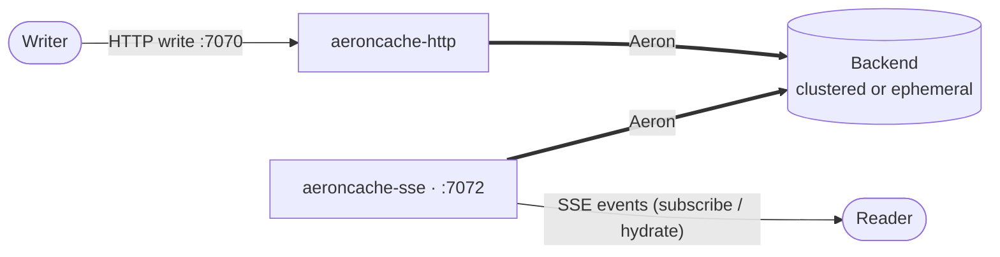

# SSE interface

> A backend plus the Server-Sent Events streaming interface — with an http writer alongside, since
> SSE is read-only.

## Overview

This pattern deploys an Aeron Cache **backend** and the **SSE interface** (`aeroncache-sse`), which
streams cache (and counter) updates to subscribers over Server-Sent Events. A client subscribes to
a cache — optionally with **hydration** (a snapshot on subscribe) — and then receives a live stream
of updates.

SSE is **uni-directional**: it is read-only, with no way to create caches or write items. So this
pattern also deploys the **HTTP interface** (`aeroncache-http`) as the **writer** — the realistic
shape, since an SSE consumer always needs something producing the data. The verify writes via http
and reads the result back over SSE.

`CACHE_TYPE` picks the backend — **`clustered`** (3-node RAFT, default) or **`ephemeral`**
(single-node SINGLE); both interfaces are wired to the same backend.

## Architecture



The sse interface exposes the SSE subscription routes (`/api/sse/v1/cache/...`,
`/api/sse/v1/cache/hydrate/...`) plus `/liveness/` and `/readiness/` on port 7072; it has no HTTP
REST data path.

## Prerequisites

- A local Kubernetes cluster via **minikube** (the default) — see the [repo README](../../README.md).
- `kubectl`, `helm`, `curl`, `jq`. Run `make doctor`.
- Clustered runs 5 pods (3 cluster nodes + sse + http); ephemeral runs 3.

## Run

```bash
make up                       # clustered backend + sse interface (+ http writer)
# or
make up CACHE_TYPE=ephemeral  # single-node ephemeral backend + sse interface (+ http writer)

make verify                   # write via http, then read it back over an SSE subscription
```

To use kind instead (as CI does): add `CLUSTER=kind`.

## Verify

`make verify` ([`verify-sse.sh`](verify-sse.sh)) port-forwards both the sse interface (7072) and the
http writer (7070), checks the sse interface's liveness/readiness, then:

1. creates a cache and puts `testKey=testValue` via **http**, and
2. subscribes to that cache over **SSE** with hydration (`/api/sse/v1/cache/hydrate/<id>`),

asserting the value streams back. A healthy deployment ends with `SSE ROUND-TRIP PASSED` then
`SMOKE PASSED`.

### Try it by hand

With both port-forwards up, in one terminal subscribe:

```bash
curl -N http://localhost:7072/api/sse/v1/cache/hydrate/demo
```

and in another, write — the event appears in the first:

```bash
curl -X POST http://localhost:7070/api/v1/cache -H 'Content-Type: application/json' -d '{"cacheId":"demo"}'
curl -X POST http://localhost:7070/api/v1/cache/demo -H 'Content-Type: application/json' -d '{"key":"k","value":"v"}'
```

## Teardown

```bash
make down            # uninstall the interfaces + backend
make cluster-down    # (optional) delete the whole cluster
```

## How it works

- **Four vendored charts** (`charts/VENDOR.lock` pins the upstream commit): the two backends
  (`aeroncache-cluster`, `aeroncache-ephemeral`), `aeroncache-sse`, and `aeroncache-http` (the writer).
- **`CACHE_TYPE` wiring** is applied to **both** interfaces (same `cacheMode` / `clusterAddresses` /
  ephemeral endpoints), so http and sse address the same backend.
- **Verify** uses the shared `common/smoke.sh` in `command` mode with a **second port-forward**
  (the http writer), then runs the SSE round-trip script.

## References

- Vendored from [aeron-cache/k8s/helm](https://github.com/bhf/aeron-cache/tree/main/k8s/helm) (`aeroncache-cluster`, `aeroncache-ephemeral`, `aeroncache-http`, `aeroncache-sse`; pinned SHA in `charts/VENDOR.lock`)
- [SSE OpenAPI](https://github.com/bhf/aeron-cache/blob/main/cache-sse/sse-openapi.yaml)
- Aeron Cache site: https://aeron-cache.pages.dev
