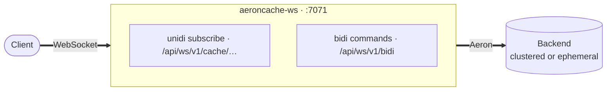

# WebSocket interface

> A backend plus only the WebSocket interface — uni-directional subscriptions *and* the
> bidirectional command endpoint.

## Overview

This pattern deploys an Aeron Cache **backend** and the **WebSocket interface** (`aeroncache-ws`)
in front of it — nothing else. The one deployment serves two things:

- **Uni-directional subscription routes** — subscribe to a cache (or a key) via the connect URL
  (`/api/ws/v1/cache/...`, `/api/ws/v1/counter/...`) and receive a snapshot plus a live stream of
  updates.
- **The bidirectional endpoint** `/api/ws/v1/bidi` — a single socket carrying the **full
  cache/counter command surface** (create, put, patch, get, delete, counters) plus dynamic
  subscribe/unsubscribe, correlated per request. This is what "bidi-ws" refers to; it is the same
  deployment, just a different endpoint on it.

`CACHE_TYPE` picks the backend — **`clustered`** (3-node RAFT, default) or **`ephemeral`**
(single-node SINGLE), exactly as in the [http pattern](../http/README.md).

Reach for this when your clients stream cache state or drive the cache over a persistent socket,
rather than polling the REST API.

## Architecture



The ws interface has **no HTTP REST data path** — it exposes the WebSocket routes plus the
`/liveness/` and `/readiness/` health endpoints on port 7071.

## Prerequisites

- A local Kubernetes cluster via **minikube** (the default) — see the [repo README](../../README.md).
- `kubectl`, `helm`, `curl`, `jq`, and **Node 22+** (for the bidi verify). Run `make doctor`.
- Clustered runs 4 pods (3 cluster nodes + ws); ephemeral runs 2.

## Run

```bash
make up                       # clustered backend + ws interface
# or
make up CACHE_TYPE=ephemeral  # single-node ephemeral backend + ws interface

make verify                   # bidi round-trip: create a cache, put an item, read it back
```

To use kind instead (as CI does): add `CLUSTER=kind`.

## Verify

Because the ws interface has no REST surface, `make verify` runs a **bidi WebSocket round-trip**
instead of the HTTP smoke: it port-forwards `svc/aeroncache-ws:7071`, checks liveness/readiness,
then (via [`verify-bidi.mjs`](verify-bidi.mjs)) opens `/api/ws/v1/bidi` and does
`CREATE_CACHE` → `ADD_CACHE_ENTRY` → `GET_CACHE_ENTRY`, asserting the value comes back. A healthy
deployment ends with `BIDI ROUND-TRIP PASSED` then `SMOKE PASSED`.

### Try it by hand

With the port-forward up (`kubectl port-forward -n aeroncache-patterns svc/aeroncache-ws 7071:7071`),
a minimal bidi exchange (Node 22+, no dependencies):

```js
const ws = new WebSocket('ws://localhost:7071/api/ws/v1/bidi');
ws.addEventListener('open', () => {
  ws.send(JSON.stringify({ type: 'command', op: 'CREATE_CACHE', correlationId: '1', cacheId: 'demo' }));
  ws.send(JSON.stringify({ type: 'command', op: 'ADD_CACHE_ENTRY', correlationId: '2', cacheId: 'demo', key: 'k', value: 'v' }));
  ws.send(JSON.stringify({ type: 'command', op: 'GET_CACHE_ENTRY', correlationId: '3', cacheId: 'demo', key: 'k' }));
});
ws.addEventListener('message', (e) => console.log(e.data)); // commandResponse frames
```

## Near cache (optional)

The ws interface can serve **hydrating subscriptions** (a `subscribe` with `sendSnapshot`) from a
**server-side near cache** — a warm local copy kept in sync by a cluster subscription, so hydration is
served locally instead of asking the cluster for a per-subscriber snapshot. It is an opt-in deployment
option, orthogonal to `CACHE_TYPE`, that sets `nearCacheEnabled=true` (`NEAR_CACHE_ENABLED`) on the
interface:

```bash
make up NEAR_CACHE=true                       # clustered backend + near cache on
make up NEAR_CACHE=true CACHE_TYPE=ephemeral  # ephemeral backend + near cache on
make verify-near                              # prove the near cache actually served the interface
```

`make verify-near` writes a cache over the bidi WebSocket, primes the near cache for it
(`POST /api/v1/near/cache/<id>`, served over HTTP on the same ws port), waits until it is listed warm
with a local item count, asserts the near-cache metric moved, and reads the item back.

**Confirming it is used.** The ws interface publishes Micrometer metrics on its own `/prometheus`
(port 7071): `aeroncache_near_warm_caches{domain="cache"}` and the `aeroncache_near_hydrations_served_total`
hit counter (a non-zero delta proves a hydration was served from the near cache, not the cluster). The
management API lists what is warm:

```bash
curl -s localhost:7071/api/v1/near/caches | jq .     # warm caches + local item counts
curl -s localhost:7071/prometheus | grep near        # the near-cache gauges/counters
```

## Teardown

```bash
make down            # uninstall the interface + backend
make cluster-down    # (optional) delete the whole cluster
```

## How it works

- **Three vendored charts** (`charts/VENDOR.lock` pins the upstream commit): the two backends
  (`aeroncache-cluster`, `aeroncache-ephemeral`) and `aeroncache-ws`.
- **`CACHE_TYPE` wiring** is identical to the http pattern: clustered uses chart defaults; ephemeral
  sets `cacheMode=SINGLE` plus `clusterAddresses` and the `ephemeralRequestEndpoint` /
  `ephemeralResponseControlEndpoint` (8075/8076) at the single node.
- **Verify** uses the shared `common/smoke.sh` in `command` mode, which handles the port-forward and
  health gate and then runs the bidi round-trip script.

## References

- Vendored from [aeron-cache/k8s/helm](https://github.com/bhf/aeron-cache/tree/main/k8s/helm) (`aeroncache-cluster`, `aeroncache-ephemeral`, `aeroncache-ws`; pinned SHA in `charts/VENDOR.lock`)
- [Bidi WebSocket OpenAPI](https://github.com/bhf/aeron-cache/blob/main/cache-ws/bidi-ws-openapi.yaml)
- Aeron Cache site: https://aeron-cache.pages.dev
